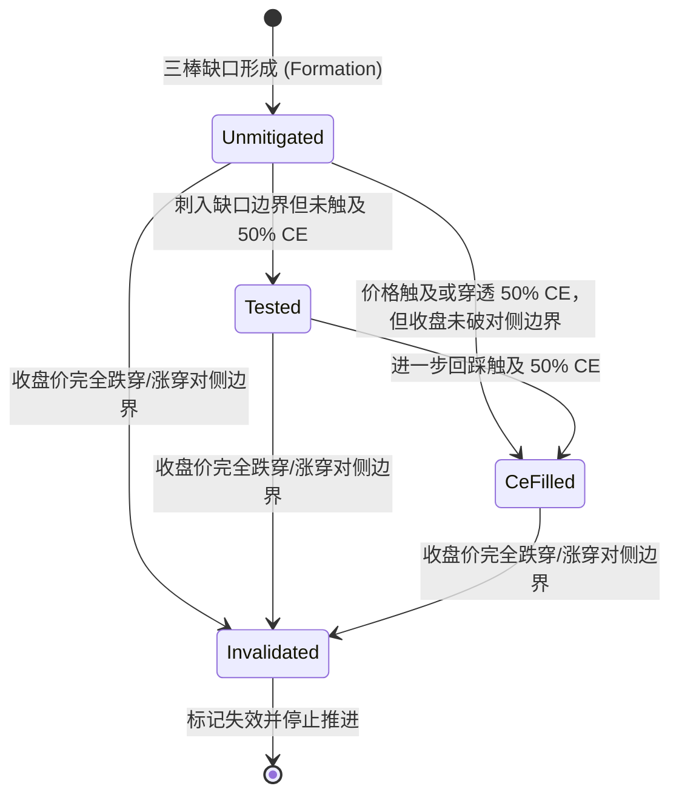

# Mist `@app/pacore`：微观价格行为、缺口失衡与空间投射架构设计方案

> **状态**：Implemented（Pure Math & Visual Core）  
> **归属仓库**：`mist`（开源主仓）  
> **所属模块**：`libs/pacore`（纯数学纯几何核心包）、`libs/visual-command`（纯图元适配器）、`tools/inspect-pa-indicators.ts`（纯几何体检工具）  
> **基准参照**：`libs/chancore`（纯数学/零I/O不可变几何引擎规范）、`libs/visual-command`（图层渲染契约）、[`docs/neckline-projection-architecture.md`](./neckline-projection-architecture.md)（形态颈线映射姊妹篇）

---

## 一、 背景与架构定位

在 Mist 系统的物理正交观测维度中，**微观价格行为 (Price Action, PA)** 负责从 K 线高低开收轨迹中提取不依赖滞后副图指标的纯几何微观结构与空间度量尺度。

为了践行 Mist 的**纯数学核心与上层业务解耦**原则，开源主仓已落地独立的西方价格行为学核心包：**`@app/pacore`（`libs/pacore`）**。

`libs/pacore` 与既有的东方缠论几何包 `libs/chancore` 形成对称的双核基石：
- **`@app/chancore`**：负责东方分形波浪几何（分型、笔、段、中枢、形态背驰）；
- **`@app/pacore`**：负责西方价格行为纯几何（三棒失衡缺口 `FairValueGap`、影线流动性真空 `WickGap`、50% CE 轴心、针形动力学 `PinBar`、扫损收回 `LiquiditySweep`、缺口空间投射 `GapProjection` 与形态颈线空间映射 `NecklineProjection`）。

---

## 二、 理论源流：PA、ICT 与 SMC 的关系与量化提炼

```
┌────────────────────────────────────────────────────────────────────────┐
│                   价格行为学 (Price Action, PA) -【总纲/父集】             │
│   • 起源: 道氏理论、威科夫量价分析、日本蜡烛图、Al Brooks 裸K交易学派          │
│   • 核心: 市场行为包容一切，直接解码价格本身的几何轨迹与结构分布              │
└───────────────────────────────────┬────────────────────────────────────┘
                                    │ 演进与特化
┌───────────────────────────────────▼────────────────────────────────────┐
│              Inner Circle Trader (ICT) -【流动性交付视角】              │
│   • 核心: 从机构流动性供需失衡与再平衡角度定义结构元素                        │
│   • 贡献: 规范化提出 FVG、Wicks as Gaps、50% CE 轴心与标准差空间投射       │
└───────────────────────────────────┬────────────────────────────────────┘
                                    │ 工业化去粗取精
┌───────────────────────────────────▼────────────────────────────────────┐
│            Smart Money Concepts (SMC) -【现代提炼/量化友好型】          │
│   • 核心: 剔除玄学叙事，将市场结构提炼为非黑即白的纯几何契约                  │
│   • 产出: 结构转换、FVG (失衡区)、Sweep (扫损收回)、空间度量投射           │
└────────────────────────────────────────────────────────────────────────┘
```

### 1. 概念澄清
- **本质上源于同一套客观市场物理规律，属于不同抽象层级**：
  - **PA 是总称（树干）**：直接基于 OHLCV 几何轨迹刻画市场结构；
  - **ICT 是微观分支（主枝）**：从流动性失衡与再平衡角度将微观结构规则化；
  - **SMC 是现代工业提炼版（果实）**：剔除主观叙事，保留可确定性编码与静态复现的几何结构定义。

### 2. 量化去神圣化（Demythologization）
在 `@app/pacore` 中，**100% 剥离任何主观叙事与交易策略语义，仅还原其纯几何与拍卖物理定义**：
- **FVG（失衡缺口）**：相邻三根 Bar 因单向供需失衡而未形成重叠的价格带；
- **Wick Gap（影线真空）**：单根 Bar 上显著长于实体的影线区间，对应次级别交易中的单边流动性真空；
- **50% CE（Consequent Encroachment）**：任意失衡区间 $[Bottom, Top]$ 的几何中位线；
- **Pin Bar / Liquidity Sweep**：单根 Bar 对关键价格水平的刺破与当根收盘收回动作。

---

## 三、 A 股连续竞价跨周期微观几何适配（1d / 30m / 5m）

`@app/pacore` 原生面向全周期纯几何序列（`1d`、`30m`、`5m` 等），其核心物理动因来自 A 股连续竞价特性：

1. **连续竞价下传统物理跳空稀缺**：
   A 股除早盘 `09:25~09:30` 集合竞价（及日线隔夜）外，盘中连续撮合相邻 Bar 开收盘价通常高度贴近（$\text{Open}_t \approx \text{Close}_{t-1}$），传统两棒实体间物理缺口在盘中很少见。
2. **三棒 FVG 与长影线 Wick Gap 提供全天候客观微观标尺**：
   即使无隔夜跳空，资金脉冲推动仍会在任意周期（`5m` / `30m` / `1d`）留下清晰的三棒影线非重叠空隙（`FairValueGap`）或单根极长影线（`WickGap` / `PinBar`）。
3. **纯几何与下游解耦定界**：
   `@app/pacore` 仅负责识别上述客观结构、追踪回补状态并计算对称/标准差几何投射值；**不定义任何买点、卖点、盈亏比、止损幅度或撮合规则**（上述决策归属下游策略与交易层）。

---

## 四、 核心数学模型与几何算法规范

> 以下严格区分 **当前已实现默认口径**（`libs/pacore/src/internal/`）与 **`[Planned / Optional Extension]`**（设计预留但默认未启用的扩展门禁），确保文档与源码 100% 对齐。

### 1. 缺口与失衡检测模型 (Gap & Imbalance Detection)

#### (1) 三棒合理价值失衡区（FVG，Fair Value Gap）
设连续 3 根 `PaK` 为 $K_{i-2}, K_{i-1}, K_i$（$i \ge 2$，`FairValueGapDetector.detect`）：
- **看涨 FVG（`FvgType.Bullish`）**：
  $$\text{Condition: } Low(K_i) > High(K_{i-2})$$
  $$\text{Gap Area: } [\text{gapBottom} = High(K_{i-2}), \quad \text{gapTop} = Low(K_i)]$$
  $$\text{gapSize} = Low(K_i) - High(K_{i-2}) > \text{minFvgSize}$$
- **看跌 FVG（`FvgType.Bearish`）**：
  $$\text{Condition: } High(K_i) < Low(K_{i-2})$$
  $$\text{Gap Area: } [\text{gapBottom} = High(K_i), \quad \text{gapTop} = Low(K_{i-2})]$$
  $$\text{gapSize} = Low(K_{i-2}) - High(K_i) > \text{minFvgSize}$$
- **参数现状与扩展规划**：
  - **已实现默认值**：`minFvgSize = 0`（只要严格存在价格空隙即检出）；
  - **`[Planned / Optional Extension]`**：中间失衡棒 $K_{i-1}$ 的实体占比过滤（如 $\text{Body} \ge 0.60 \times \text{Range}$）与基于 `ATR(14)` 的动态最小缺口阈值，目前尚未内置于 `FairValueGapDetector`（`PaAnalysisOptions.atrThreshold` 当前仅在类型中预留，暂未接入计算）。

#### (2) 影线流动性真空区（Wick-as-Gap）
对单根 `PaK`（`WickGapDetector.detect`），设 $\text{Range} = H - L > 0$，$\text{Body} = |C - O|$：
- **看涨下影线真空（`PinBarDirection.Bullish`）**：
  $$\text{LowerWick} = \min(O, C) - L \ge \text{wickToBodyMultiple} \times \text{Body} \quad \land \quad \text{LowerWick} \ge \text{minWickSize} \quad \land \quad \text{LowerWick} > \text{UpperWick}$$
  $$\text{Gap Area: } [\text{bottom} = L, \quad \text{top} = \min(O, C)]$$
- **看跌上影线真空（`PinBarDirection.Bearish`）**：
  $$\text{UpperWick} = H - \max(O, C) \ge \text{wickToBodyMultiple} \times \text{Body} \quad \land \quad \text{UpperWick} \ge \text{minWickSize} \quad \land \quad \text{UpperWick} > \text{LowerWick}$$
  $$\text{Gap Area: } [\text{bottom} = \max(O, C), \quad \text{top} = H]$$
- **参数现状**：`wickToBodyMultiple` 默认 `2.0`，`minWickSize` 默认 `0`；`ATR(14)` 相对门禁属于 `[Planned / Optional Extension]`。

#### (3) 50% CE (Consequent Encroachment) 轴心计算
对于任意失衡带 $G = [\text{bottom}, \text{top}]$：
$$\text{CE}(G) = \frac{\text{bottom} + \text{top}}{2.0}$$

---

### 2. 缺口生命周期有限状态机 (`FvgMitigationStatus`)

`FairValueGapDetector.detect` 沿后续 K 线 $K_j$（$j > \text{endIndex}$）单调推进每条 FVG 的客观回补状态（`FvgMitigationStatus`）：



- **`Unmitigated`**：后续 K 线尚未触及缺口近端边界（看涨 `gapTop` / 看跌 `gapBottom`）；
- **`Tested`**：价格已刺入缺口近端边界，但尚未触及 `50% CE`；
- **`CeFilled`**：价格已触及或穿越 `50% CE`，但当根及后续收盘价尚未穿透缺口远端边界；
- **`Invalidated`**：出现收盘价彻底跌破看涨缺口 `gapBottom`（或涨破看跌缺口 `gapTop`），记录 `firstMitigatedTime` / `firstMitigatedIndex` 后立即终止状态推进。

---

### 3. 上下空间投射引擎 (`GapProjectionEngine`)

`GapProjectionEngine.project(fvg, originPrice?)` 基于 `fvg.gapSize` 与 `50% CE` 计算对称度量目标与标准差扩展位：

1. **对称度量投射 (`measuredTarget`)**：
   $$\text{measuredTarget} = 2.0 \times \text{CE} - \text{origin}$$
   - **调用注意（重要）**：`originPrice` 为可选参数。若省略 `originPrice`，当前实现默认取 `origin = fvg.gapBottom`（看涨）或 `fvg.gapTop`（看跌），此时 `2 * CE - origin` 在数值上等于 `fvg.gapTop` / `fvg.gapBottom`（即缺口自身远端边界）；**仅当调用方显式传入结构起涨/起跌基准价 `originPrice` 时，才会输出向外部对称延伸的目标位**。
2. **标准差倍数投射 (`sdTargets`)**：
   - **看涨 FVG (`direction = 'up'`)**：`sd1_0 = gapTop + 1.0 * H`，`sd2_0 = gapTop + 2.0 * H`，`sd2_5 = gapTop + 2.5 * H`，`sd4_0 = gapTop + 4.0 * H`；
   - **看跌 FVG (`direction = 'down'`)**：`sd1_0 = gapBottom - 1.0 * H`，`sd2_0 = gapBottom - 2.0 * H`，`sd2_5 = gapBottom - 2.5 * H`，`sd4_0 = gapBottom - 4.0 * H`；
   - 其中 $H = \text{fvg.gapSize}$。

---

### 4. 针形动力学与扫损检测 (`PinBarDetector` & `LiquiditySweepDetector`)

#### (1) Pin Bar 检测 (`PinBarDetector.detect`)
设 $\text{totalRange} = H - L > 0$：
- **已实现默认值与条件**：
  - `minWickRatio = 0.50`，`maxBodyRatio = 0.33`，`minRange = 0`；
  - 实体压缩约束：$\text{bodyRatio} = \frac{|C - O|}{\text{totalRange}} \le \text{maxBodyRatio}$；
  - **看涨探底针 (`PinBarDirection.Bullish`)**：$\frac{\text{lowerWick}}{\text{totalRange}} \ge \text{minWickRatio} \land \text{lowerWick} > \text{upperWick} \land C \ge L + 0.5 \times \text{totalRange}$；
  - **看跌受阻针 (`PinBarDirection.Bearish`)**：$\frac{\text{upperWick}}{\text{totalRange}} \ge \text{minWickRatio} \land \text{upperWick} > \text{lowerWick} \land C \le L + 0.5 \times \text{totalRange}$。
- **`[Planned / Optional Extension]`**：更严格的 `0.60 / 0.25` 比例、收盘 `0.66 / 0.33` 分位门禁及 `NormalizedRange = Range / ATR(14) >= 0.85` 均可通过显式参数或后续扩展支持，当前默认不启用。

#### (2) 扫损收回检测 (`LiquiditySweepDetector.detectSweep`)
- **已实现方法**：`PaCore.checkLiquiditySweep(bar, barIndex, levelPrice, type)`（由调用方显式传入待检验结构参考位 `levelPrice` 与扫损方向 `SweepType.BullishSweep | BearishSweep`）：
  - `BullishSweep`：`bar.low < levelPrice && bar.close >= levelPrice`，返回 `sweepDepth = levelPrice - bar.low` 与 `rejectionWickRatio = (bar.close - bar.low) / totalRange`；
  - `BearishSweep`：`bar.high > levelPrice && bar.close <= levelPrice`，返回 `sweepDepth = bar.high - levelPrice` 与 `rejectionWickRatio = (bar.high - bar.close) / totalRange`。
- **现状说明**：`PaCore.executeFullAnalysis` 当前因无外部参考位上下文，返回 `sweeps: []`；基于 `ATR(14)` 的最小刺破深度过滤属于 `[Planned / Optional Extension]`。

### 5. 形态颈线空间映射 (`NecklineProjectionEngine`)
`PaCore.findNecklines(klines, options?)` 已在 `libs/pacore/src/internal/neckline-projections.ts` 落地，完整理论与公式见姊妹文档 [`docs/neckline-projection-architecture.md`](./neckline-projection-architecture.md)。
- **实现对齐说明**：`NecklineProjectionEngine` 当前默认值是 `swingWindow = 2`、`maxTroughDifferenceRatio = 0.05`、`minPatternHeightRatio = 0.01`、`minBarSpan = 4`、`maxBarSpan = 120`（与 `contracts.ts` 注释及姊妹文档写的 `3 / 0.03 / 0.015 / 8` 有差异，后续可按需显式传参或对齐默认值）；另外在 `Breakout` 状态递推中若同一根 Bar 同时满足 `target1_0` 与回踩 `retestZone`，当前顺序会先置 `TargetReached` 再被 `PullbackRetested` 覆盖，调用方消费状态时需注意。

---

## 五、 跨层纯边界与上游映射契约

在 Mist 系统架构中，`@app/pacore` 处于最底层纯数学几何域，严格遵循以下边界与数据流契约：

1. **三类 K 线模型正交隔离（`StrategyBar` vs `ChanK` vs `PaK`）**：
   - 运行时 fact 层使用 `StrategyBar`（`@app/market-data`）；
   - `libs/pacore` 只消费纯净极简的 [`PaK`](../libs/pacore/src/contracts.ts#L29-L38)（`id, time, open, high, low, close, volume?, amount?`），**禁止反向依赖 `@app/market-data` 或 `@app/strategy`**；
   - 唯一合法转换入口为 [`libs/strategy/src/analysis/pure-bar-mapper.ts`](../libs/strategy/src/analysis/pure-bar-mapper.ts#L57-L72) 中的 `toPaKSeries`，逐字复制 `StrategyBar.timestamp` 至 `PaK.time`，不做任何时间偏移或取整。
2. **输入校验边界 (`assertPaKSeries`)**：
   - [`assertPaKSeries`](../libs/pacore/src/internal/assert-pa-k-series.ts#L4-L39) 校验数组非空、`high >= low`、OHLC 有限无 NaN 及 `time` 严格单调递增（注意：当前实现暂未校验 `<= 0` 价格）。
3. **交易层/策略层彻底外置**：
   - 上层决策流求值（`StrategyEvaluationKernel`）、聚合分组（`groupSignals`）、交易裁决与账本（`TradingEngine`）以及具体信号/出场策略逻辑均位于 `@app/pacore` 之外，**不在本包或本文档中耦合任何交易规则**。

---

## 六、 系统工程架构设计：独立包 `libs/pacore`

### 1. Monorepo 真实目录布局

```
mist/libs/pacore/
├── tsconfig.lib.json                      # 库编译配置
└── src/
    ├── index.ts                           # 统一公开导出 (contracts, errors, pa-core)
    ├── contracts.ts                       # 领域枚举与接口 (PaK, FairValueGap, WickGap, PinBar, LiquiditySweep, GapProjection, NecklineProjection)
    ├── errors.ts                          # PacoreError / InvalidSeriesError
    ├── pa-core.ts                         # 统一静态门面 PaCore
    ├── pa-core.spec.ts                    # 门面单测
    ├── pacore-boundary.guard.spec.ts      # 纯边界刚性门禁 (CI 守护)
    └── internal/
        ├── assert-pa-k-series.ts          # 序列完整性与单调性校验
        ├── fair-value-gap.ts              # (+ .spec.ts) 三棒 FVG 与回补状态机
        ├── wick-gap.ts                    # (+ .spec.ts) 影线流动性真空检测
        ├── pin-bar.ts                     # (+ .spec.ts) Pin Bar 动力学检测
        ├── liquidity-sweep.ts             # 关键位扫损收回检测 (待补 .spec.ts)
        ├── gap-projections.ts             # (+ .spec.ts) 缺口对称度量与 SD 投射
        └── neckline-projections.ts        # (+ .spec.ts) 颈线形态与空间映射
```

> **公开门面 API (`PaCore`)**：`assertSeries`、`findFairValueGaps`、`findWickGaps`、`findPinBars`、`checkLiquiditySweep`、`calculateProjection`、`findNecklines`、`executeFullAnalysis`、`analyze`。

### 2. 纯边界铁律契约 (`pacore-boundary.guard.spec.ts`)
1. **纯数学不可变**：输入为只读 `readonly PaK[]`，输出纯几何结构，不持有任何跨会话可变单例状态；
2. **零 I/O 与零外部重度依赖**：严禁 `import` `@nestjs/*`、`typeorm`、`ioredis`、`axios` 或任意跨层 `@app/*` 业务包，严禁访问 `process.env` 或执行文件/网络 I/O；
3. **无容器可测**：所有算子均可脱离 NestJS 容器直接通过 Jest 单测执行。

---

## 七、 跨模块分工与协作链路

```
┌────────────────────────────────────────────────────────────────────────┐
│                           libs/pacore                                  │
│      (纯数学/纯几何内核: FVG / WickGap / PinBar / Sweep / Projection / Neckline) │
└───────────────────┬───────────────────────────────┬────────────────────┘
                    │ 纯几何输出                    │ 纯数学消费 (via toPaKSeries)
                    ▼                               ▼
┌────────────────────────────────────┐  ┌────────────────────────────────┐
│       libs/visual-command          │  │   下游消费边界 (策略/交易层)     │
│     (图元适配器: PaVisualAdapter)    │  │                                │
│  • BandVisualCommand: FVG 色带     │  │  • 信号层: StrategyEvaluationKernel │
│  • LineVisualCommand: CE虚线 /     │  │  • 聚合层: groupSignals         │
│    1:1投射点线 / 颈线与扩展线       │  │  • 交易层: TradingEngine        │
│  • Icon/TextVisualCommand: Pin标记 │  │  (策略规则与专有Alpha严格外置)    │
└────────────────────────────────────┘  └────────────────────────────────┘
```

- **视觉图元现实契约**：[`visual-command.types.ts`](../libs/visual-command/src/visual-command.types.ts#L3) 支持 `'line' | 'band' | 'text' | 'icon'` 四种图元（无 `BoxVisualCommand`）。[`PaVisualAdapter`](../libs/visual-command/src/adapters/pa-visual.adapter.ts#L38-L341) 当前输出：
  - `pa_fvg`：`BandVisualCommand`（FVG 半透明色带）；
  - `pa_fvg_ce`：`LineVisualCommand`（50% CE 虚线）；
  - `pa_projection`：`LineVisualCommand`（1:1 `measuredTarget` 点线）；
  - `pa_pin`：`IconVisualCommand` + `TextVisualCommand`（Pin Bar 箭头与文案）；
  - `pa_neckline`：`LineVisualCommand` + `TextVisualCommand` + `BandVisualCommand`（颈线、骨架、高差标尺、1.0/1.618 目标线、回抽带）。

---

## 八、 实施现状、已知缺口与诊断工具

本方案核心基础设施均已在 `mist` 主仓落地，当前真实工程状态与遗留改进项清单如下：

### Batch 0: Monorepo 工程基准（已落地）
- `mist/tsconfig.json`、`mist/nest-cli.json`、`mist/package.json`（`jest.moduleNameMapper`）及 `mist/libs/pacore/tsconfig.lib.json` 均已配置 `@app/pacore` 映射并纳入类型检查与单测。

### Batch 1: 纯数学几何内核 `libs/pacore`（已落地 + 已知缺口）
- **已落地**：`contracts.ts`、`errors.ts`、`pa-core.ts`、`pacore-boundary.guard.spec.ts` 及 6 个核心算子（FVG / WickGap / PinBar / LiquiditySweep / GapProjection / NecklineProjection）。
- **已知缺口 / 后续待收口**：
  1. `OrderBlock` / `OrderBlockType` 尚未实现，已延期；
  2. `internal/liquidity-sweep.spec.ts` 缺失单元测试；
  3. `PaTrendDirection` 枚举与 `PaAnalysisOptions.atrThreshold` 当前未被调用；
  4. `assertPaKSeries` 尚未拦截 `<= 0` 的非正价格；
  5. `GapProjectionEngine.project` 未传 `originPrice` 时退化、`NecklineProjectionEngine` 同 Bar `TargetReached` 与 `PullbackRetested` 覆写问题、以及 `NecklineOptions` 默认值与注释对齐。

### Batch 2: 视觉指令图层适配器 `libs/visual-command`（已落地 + 已知缺口）
- **已落地**：[`pa-visual.adapter.ts`](../libs/visual-command/src/adapters/pa-visual.adapter.ts) 与 [`visual-command.service.ts`](../libs/visual-command/src/visual-command.service.ts#L85-L105) 的图层分发及配套单测。
- **已知缺口 / 后续待收口**：
  1. `VisualCommandService` 分发中未单独识别 `layers` 里的 `'pa_fvg_ce'` 字符串，且存在 `klines as any` 强转；
  2. `PaVisualAdapter` 暂未渲染 `WickGap`、`LiquiditySweep` 及 FVG `+1.0 / +2.0 SD` 空间箱体/水平线，且对 `Forming`/`Invalidated` 颈线仍绘制目标投影线；
  3. 需确认上游 DTO 是否完整开放 `paOptions` 透传。

### Batch 3: 纯技术指标诊断体检工具（已落地 + 已知缺口）
- **已落地**：[`tools/inspect-pa-indicators.ts`](../tools/inspect-pa-indicators.ts) 与共享 K 线加载器 [`tools/strategy-dev/pa-kline-loader.ts`](../tools/strategy-dev/pa-kline-loader.ts)（默认读取 `mist/.data/kline` 且从头部 `.slice(0, limit)` 取样）。
- **已知缺口 / 后续待收口**：
  1. `inspect-pa-indicators.ts:61` 当前把 `FvgMitigationStatus.Tested` 打印文案误标为“触碰 50% CE 轴心反弹有效”（实际代码中 `Tested` 是触及外沿但未到 CE，触及 CE 是 `CeFilled`）；
  2. 当前工具仅统计 FVG 数量与状态分布、Pin Bar 密度、单条示例 `GapProjection` 与颈线 `TargetReached` 比例，尚未实现 50% CE 次根排斥概率、Pin Bar 刺破深度分布或全样本 SD 达标率分布。
