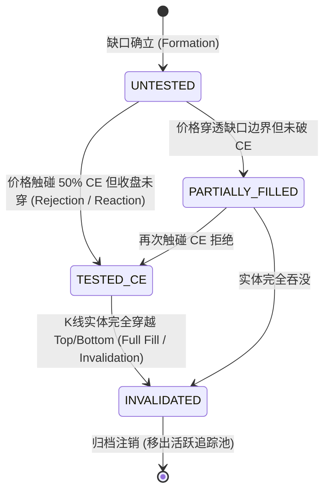
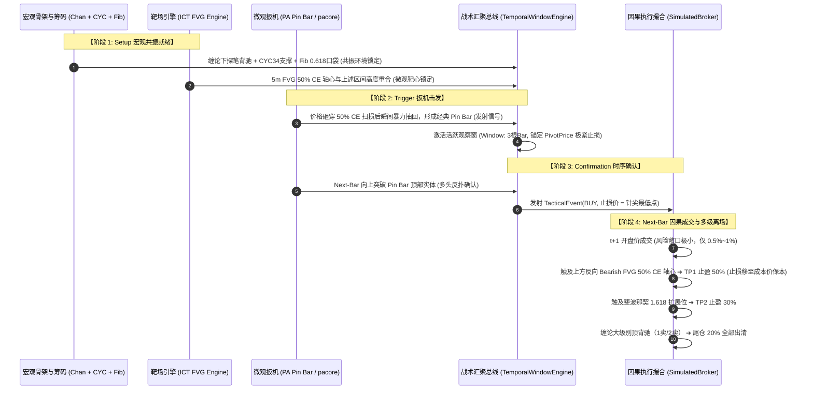

# Mist `@app/pacore`：微观价格行为、缺口失衡与空间投射架构设计方案

> **状态**：Draft / Architecture Baseline  
> **归属仓库**：`mist`（开源主仓）  
> **所属模块**：`libs/pacore`（拟新增独立纯数学核心包）  
> **基准参照**：`libs/chancore`（纯数学/零I/O不可变几何引擎规范）、`libs/visual-command`（图层渲染契约）

---

## 一、 背景与架构定位

在 Mist 系统的六大物理正交观测维度中，**【维度 4：微观价格行为 (Price Action, PA)】** 承担着从宏观波段到微观订单流碰撞的“发令枪”与“微观空间度量”使命。

与传统通过手写命令式循环、将单根 K 线影线判断混杂在具体业务插件里的初级做法不同，为了践行 Mist 的**三层解耦体系**与**纯数学不可变几何**标准，我们决定在开源主仓中建立独立的西方价格行为学核心包：**`@app/pacore`（`libs/pacore`）**。

`libs/pacore` 将与既有的东方缠论几何包 `libs/chancore` 形成完美对称的双核基石：
- **`@app/chancore`**：负责东方分形波浪几何（分型、笔、段、中枢、形态背驰）；
- **`@app/pacore`**：负责西方订单流微观几何（失衡缺口 FVG、影线流动性真空 Wick-as-Gap、50% CE 轴心、上下空间投射）。

---

## 二、 理论源流：PA、ICT 与 SMC 的关系与量化提炼

```
┌────────────────────────────────────────────────────────────────────────┐
│                   价格行为学 (Price Action, PA) -【总纲/父集】             │
│   • 起源: 道氏理论、威科夫量价分析、日本蜡烛图、Al Brooks 裸K交易学派          │
│   • 核心: 市场行为包容一切，摒弃传统滞后指标，直接解码价格本身的几何轨迹与强弱  │
└───────────────────────────────────┬────────────────────────────────────┘
                                    │ 演进与特化
┌───────────────────────────────────▼────────────────────────────────────┐
│              Inner Circle Trader (ICT) -【算法交付/机构视角】           │
│   • 核心: 市场由机构做市算法驱动，散户经典形态多为流动性诱饵 (Liquidity Pools) │
│   • 贡献: 规范化提出 FVG、Order Block、Wicks as Gaps、50% CE 轴心与标准差投射 │
└───────────────────────────────────┬────────────────────────────────────┘
                                    │ 工业化去粗取精
┌───────────────────────────────────▼────────────────────────────────────┐
│            Smart Money Concepts (SMC) -【现代提炼/量化友好型】          │
│   • 核心: 剔除 ICT 阴谋论玄学叙事，将机构足迹提炼为高清晰度的微观结构契约      │
│   • 产出: BOS (结构突破)、CHoCH (结构跃迁)、FVG (失衡区)、Discount/Premium    │
└────────────────────────────────────────────────────────────────────────┘
```

### 1. 概念澄清：它们是一套技术吗？
- **本质上源于同一套客观市场物理规律，但属于不同的抽象层级与封装版本**：
  - **PA 是总称（树干）**：任何不依赖副图指标、仅靠价格本身高低开收与成交量做决策的技术都属于广义 PA；
  - **ICT 是深度分支（主枝）**：从大资金流动性掠夺与再平衡角度，将 PA 高度规则化、概念化；
  - **SMC 是现代工业提炼版（果实）**：由全球量化与高频交易社区将 ICT 的核心精华进一步去粗取精，提炼出非黑即白的结构性定义，极度契合算法建模。

### 2. 量化去神圣化（Demythologization）
在 `@app/pacore` 中，我们**彻底摒弃** ICT 社区关于“神秘算法在幕后操控”的玄学阴谋论叙事，**100% 还原其微观拍卖与流动性物理本质**：
- **FVG 不是神话**：它就是大额买单/卖单瞬时击穿导致的流动性单边交付（单向供需失衡）；
- **影线不是玄学**：它就是微观级别（Sub-level / Tick）发生剧烈价格扫荡并被反向吸收（Absorption）的物理驻留痕迹；
- **50% CE 不是巧合**：它是双边拍卖理论中单笔失衡区间的折现中位再平衡点（Fair Value Mean）。

---

## 三、 5 分钟级别（5m）A 股微观物理机制适配

为什么本方案**首期严格定焦于 5 分钟级别（5m）**？

1. **A 股连续竞价的物理现实**：
   A 股除早盘 09:25~09:30 集合竞价产生物理跳空外，盘中 47 根 5m Bar 处于连续撮合中，相邻 Bar 开收盘价几乎完全重合（$Open_t \approx Close_{t-1}$）。在盘中寻找教科书式的传统跳空缺口必然面临“数据断粮”。
2. **“影线算缺口”与“三棒 FVG”激活微观世界**：
   在 5 分钟级别上，盘中资金脉冲清扫必然在 1~3 根 K 线上留下显著的三棒影线交错空隙（FVG）或长影线。这构成了 5 分钟级别最真实、高频且富含统计显著性的微观失衡。
3. **因果撮合下的盈亏比优势**：
   日线级别信号因为 Next-Bar 撮合因果律会遭遇追高风险与止损敞口过大的问题。而在 5 分钟级别上，日内即可完成“失衡出现 $\to$ 回踩 50% CE 拒绝 $\to$ Next-Bar 撮合”，单笔止损仅需挂在 5m 影线极值点（风险敞口仅 0.5%~1%），配合向上投射目标位，盈亏比显著提升至 $3:1$ 以上。

---

## 四、 核心数学模型与几何算法规范

### 1. 缺口与失衡检测模型 (Gap & Imbalance Detection)

#### (1) 三棒合理价值失衡区（FVG，Fair Value Gap）
设连续 3 根 5 分钟 K 线为 $B_{t-2}, B_{t-1}, B_t$：
- **看涨 FVG（Bullish FVG）**：
  $$\text{Condition: } Low(B_t) > High(B_{t-2})$$
  $$\text{Gap Area: } [\text{Bottom} = High(B_{t-2}), \quad \text{Top} = Low(B_t)]$$
  $$\text{Height: } H_{fvg} = Low(B_t) - High(B_{t-2})$$
  *过滤门禁*：中间 $B_{t-1}$ 必须为强实体阳线（$Body \ge 0.60 \times Range$ 且 $H_{fvg} \ge \tau_{min} \cdot \text{ATR}$）。

- **看跌 FVG（Bearish FVG）**：
  $$\text{Condition: } High(B_t) < Low(B_{t-2})$$
  $$\text{Gap Area: } [\text{Bottom} = High(B_t), \quad \text{Top} = Low(B_{t-2})]$$
  $$\text{Height: } H_{fvg} = Low(B_{t-2}) - High(B_t)$$

#### (2) 影线流动性真空区（Wick-as-Gap）
当单根 5 分钟 K 线展现出极长影线时，次级别（1m/分时）必然存在流动性真空：
- **长下影线真空（Bullish Wick Gap）**：
  $$\text{LowerWick} = \min(O, C) - L \ge 2.0 \times |C - O| \quad \land \quad \text{LowerWick} \ge 0.5 \times \text{ATR}(14)$$
  $$\text{Gap Area: } [\text{Bottom} = L, \quad \text{Top} = \min(O, C)]$$
- **长上影线真空（Bearish Wick Gap）**：
  $$\text{UpperWick} = H - \max(O, C) \ge 2.0 \times |C - O| \quad \land \quad \text{UpperWick} \ge 0.5 \times \text{ATR}(14)$$
  $$\text{Gap Area: } [\text{Bottom} = \max(O, C), \quad \text{Top} = H]$$

#### (3) 50% CE (Consequent Encroachment) 轴心计算
对于任意失衡带 $G = [Bottom, Top]$：
$$\text{CE}(G) = \frac{Bottom + Top}{2.0} = Bottom + 0.5 \times H_{gap}$$

---

### 2. 缺口生命周期有限状态机 (Gap Mitigation FSM)

缺口并非静态标记，每个生成的失衡带均由确定性状态机追踪其生命周期：



- **`UNTESTED`（未测试）**：新鲜生成的磁吸区，具有强大的方向牵引力；
- **`TESTED_CE`（测试拒绝）**：微观价格回踩恰好触碰 50% CE 轴心，但当根 Bar 收盘价迅速弹回失衡区间外（Rejection），**此为极高胜率发令枪状态**；
- **`INVALIDATED`（完全回补）**：后续 K 线实体（Close）完全穿越缺口对侧边界，代表单向流动性已被充分再平衡，该缺口立即移出活跃集合。

---

### 3. 上下空间投射引擎 (Spatial Projections)

在失衡缺口确立后，基于缺口几何属性向外执行双轨空间投射：

#### (1) 对称度量投射（Measured Move / Midpoint Projection）
将缺口或其 50% CE 视为单边推动的中点：
- **向上度量投射**（波段起涨点为 $L$）：
  $$Target_{measured} = \text{CE} + (\text{CE} - L) = 2 \cdot \text{CE} - L$$

#### (2) 标准差倍数投射（Standard Deviation Projections）
以缺口垂直高度 $H_{gap}$ 为基准单位 1.0，向外投射分层目标箱体：
- **+1.0 SD**：$\text{Top} + 1.0 \times H_{gap}$（第一目标满足区，减仓/提损至保本）；
- **+2.0 ~ +2.5 SD**：$\text{Top} + 2.0 \times H_{gap} \sim \text{Top} + 2.5 \times H_{gap}$（统计学最高胜率机构止盈区，全平或分批锁定）；
- **+4.0 SD**：$\text{Top} + 4.0 \times H_{gap}$（动能耗尽极限区，警惕反转）。

---

### 4. 针形拒绝与流动性扫损引擎 (Multi-Timeframe Pin Bar & Liquidity Sweep)

“缺口（FVG/Wick Gap）”与“针（Pin Bar）”是同一枚硬币的两面：
- **缺口是“空间场地与靶向”（Setup & Target）**：描绘流动性失衡带、磁吸区与回补阻力；
- **针是“物理碰撞发令枪”（Trigger & Execution）**：当价格行进到关键结构位（缺口 50% CE、中枢边界、成本线）时，通过一根坚决的“针”完成试盘、扫损与拒绝。

#### (1) 跨周期物理定位与分工契约（5m, 30m, 日线）

与传统跳空在 5m 盘中“断粮”不同，**针（Pin Bar）属于纯粹的单根 K 线拓扑学结构，天然支持任意周期（5m、30m、日线全天候覆盖）**：

| 时间周期 | 周期物理定位 | 机构博弈内涵 | 战术职责与撮合模式 |
| :---: | :--- | :--- | :--- |
| **日线 (1d)** | **宏观机构绝望探底**<br>*(Macro Shakeout)* | 大盘系统性恐慌盘出清（如 2024-02-06 或 2026-10-23 探底 3574 暴力收回百点大长腿）。 | 确立宏观波段大底；为次级别提供最高权威的底层防守铁板（`pivotPrice` 极值）。 |
| **30分钟 (30m)** | **日内波段转折中枢**<br>*(Session Turning Point)* | 捕捉早盘 09:30~10:00 恐慌砸盘并在 10:30 前强力拉回，或午后 14:00 突发洗盘收回。 | 日内波段主攻发令；当天上午即可完成确认，避免日线收盘后的追高惩罚。 |
| **5分钟 (5m)** | **微观狙击与精准扫损**<br>*(Sniper Trigger & Sweep)* | 在 30m/日线关键位（如 FVG 50% CE 或 CYC13）上的精准试盘拒绝与诱空扫损（Spring）。 | 微观发令枪；提供极致紧凑的单笔止损敞口（$\le 0.5\% \sim 1\%$），实现 $3:1 \sim 5:1$ 盈亏比。 |

#### (2) 针形动力学统一数学模型

为杜绝震荡小十字星白噪声，一根合格的工业级 Pin Bar 必须满足四大刚性约束：

1. **影线动力学占比门禁**：
   - **看涨探底针（Bullish Pin Bar / Hammer）**：
     $$\text{LowerRatio} = \frac{\min(O, C) - L}{H - L + \epsilon} \ge 0.60 \quad \land \quad \text{BodyRatio} = \frac{|C - O|}{H - L + \epsilon} \le 0.25$$
     $$\text{收盘位置门禁: } C \ge L + 0.66 \times (H - L) \quad (\text{必须收在当根 K 线中高位})$$
   - **看跌冲高受阻针（Bearish Shooting Star）**：
     $$\text{UpperRatio} = \frac{H - \max(O, C)}{H - L + \epsilon} \ge 0.60 \quad \land \quad \text{BodyRatio} \le 0.25$$
     $$\text{收盘位置门禁: } C \le L + 0.33 \times (H - L) \quad (\text{必须收在当根 K 线中低位})$$

2. **ATR 动态波动率标准化归一**：
   单根 Bar 振幅必须具备统计显著性，杜绝低波动阴跌中的无量假针：
   $$\text{NormalizedRange} = \frac{H - L}{\text{ATR}(14)} \ge 0.85$$

3. **流动性扫损与回收深度（Liquidity Sweep & Reclaim）**：
   当价格碰撞某一关键结构位 $Level$（如 FVG 50% CE、中枢 ZD 或前低）时：
   $$\text{SweepDepth} = \frac{\max(0, Level - L)}{\text{ATR}(14)} \ge 0.20 \quad (\text{必须下探穿透关键位至少 0.2 ATR 触发止损})$$
   $$\text{ReclaimCondition} = C \ge Level \quad (\text{收盘必须坚决拉回关键位之上，完成诱空扫损})$$

#### (3) 多周期分形级联确认（Fractal Cascade）
- **日线定结构**：日线 FVG 50% CE 轴心确立宏观强支撑；
- **30m 定形态**：30m 价格进入日线支撑带，出现量能收敛与初步钝化；
- **5m 抓扳机**：5m 出现满足 Sweep & Reclaim 的标准看涨 Pin Bar，Next-Bar 立即以微观极小止损撮合入场。

---

## 五、 宏观与微观跨流派大统合：零冲突正交共振体系

### 1. “针（Pin Bar）”的理论正统性：匹诺曹 Bar 的博弈论内核
- **命名考证**：当代技术分析大师 Martin J. Pring 在其著作中首次系统提出 **Pinocchio Bar（匹诺曹 Bar）**。童话中匹诺曹一说谎鼻子就会变长；盘面上一旦向上刺破阻力或向下砸穿支撑拉出极长影线，正是在向市场“大声说谎（假突破陷阱）”。
- **理论谱系**：古典日本蜡烛图（锤头/射击之星） $\to$ 威科夫理论（Spring 弹簧扫荡） $\to$ 现代裸 K 学派（Al Brooks / Nial Fuller Pin Bar） $\to$ SMC/ICT（Liquidity Sweep 扫损与 Rejection Wick）。“针”是现代 Price Action 体系中经过 300 年实战淬炼的皇冠明珠。

### 2. 为什么多理论在散户手中冲突，而在量化体系中严格正交？
- **散户陷阱（同维度平铺打架）**：散户让缠论、成本线、斐波那契、缺口和针同时作为“投票法官”，导致信号互相打架死锁。
- **量化正交分层（五位一体）**：
  1. **缠论几何 (`chancore`)** ➔ **【拓扑骨架】**：回答“处于走势演化的哪个宏观相位（笔/段/中枢/背驰预备区）”；
  2. **CYC / CYS 筹码均线** ➔ **【能量势阱】**：回答“市场主力平均成本在哪？短线筹码是否踩踏出清？”；
  3. **斐波那契共振** ➔ **【测距标尺】**：回答“波段自相似性折返的黄金口袋（0.618~0.66）与远期靶向位在哪？”；
  4. **ICT/SMC 缺口 (FVG)** ➔ **【微观靶场】**：回答“大资金市价扫单留下的失衡磁吸区在哪？50% CE 轴心在哪？”；
  5. **PA 针形 (Pin Bar)** ➔ **【发令枪与子弹】**：回答“微观碰撞瞬间谁赢了？极紧止损定在哪？”。

### 3. 战术事件总线下的无冲突协同实战链路



---

## 六、 系统工程架构设计：独立包 `libs/pacore`

### 1. monorepo 目录布局

```
mist/libs/pacore/
├── package.json
├── tsconfig.lib.json
├── src/
│   ├── index.ts                           # 统一公开导出
│   ├── pacore-boundary.guard.spec.ts      # 纯边界刚性门禁 (CI守护)
│   ├── types/
│   │   ├── gap.types.ts                   # 缺口、FVG、WickGap 核心类型
│   │   ├── pinbar.types.ts                # 针形(Pin Bar)、扫损(Sweep)类型
│   │   ├── projection.types.ts            # 投射目标、箱体定义
│   │   └── pa-result.types.ts             # 最终几何输出结构
│   ├── detectors/
│   │   ├── fvg-detector.ts                # 三棒 FVG 检测器
│   │   ├── wick-gap-detector.ts           # 影线真空检测器
│   │   ├── pinbar-detector.ts             # 多周期 Pin Bar 动力学检测器
│   │   ├── liquidity-sweep-detector.ts    # 关键位扫损收回 (Sweep & Reclaim) 检测器
│   │   └── ce-calculator.ts               # 50% CE 轴心与加权中点
│   ├── state-machine/
│   │   └── gap-lifecycle-tracker.ts       # 缺口生命周期追踪状态机 (Untested -> Tested -> Invalidated)
│   ├── projections/
│   │   └── gap-projection-engine.ts       # 空间对称投射与标准差倍数计算
│   └── pacore-engine.ts                   # 门面调度器 (Facade: executePaAnalysis)
```

### 2. 纯边界铁律契约 (`pacore-boundary.guard.spec.ts`)

全面继承 `@app/chancore` 的军规级防线：
1. **纯数学不可变**：输入为只读 K 线序列 `readonly StrategyBar[]`，输出纯几何对象，内部不持有可变跨会话单例状态；
2. **零 I/O 与零外部依赖**：
   - 严禁 `import` `@nestjs/*`、`typeorm`、`ioredis`、`axios` 或任何数据库驱动；
   - 严禁读取 `process.env` 或执行任何控制台/文件 I/O；
   - 仅允许依赖 `@app/decimal` 或轻量基础数学库；
3. **TA-Lib 双轨与纯函数可测**：所有检测器均可脱离 NestJS 容器直接在 Node/Jest 裸跑。

---

## 六、 跨模块分工与协作链路

```
┌────────────────────────────────────────────────────────────────────────┐
│                           libs/pacore                                  │
│             (西方价格行为 PA 纯几何内核: FVG / 影线缺口 / CE / 投射)           │
└───────────────────────────────────┬────────────────────────────────────┘
                                    │ 导出纯几何对象 (PaGeometryResult)
┌───────────────────────────────────▼────────────────────────────────────┐
│                        libs/visual-command                             │
│                  (图元适配器: PaVisualAdapter)                           │
│   • BandVisualCommand: 绘制 FVG 半透明色带 (绿涨红跌)                      │
│   • LineVisualCommand: 绘制 50% CE 虚线 (Consequent Encroachment)       │
│   • BoxVisualCommand: 绘制 +1.0 / +2.0 SD 投射目标箱体                    │
└───────────────────────────────────┬────────────────────────────────────┘
                                    │ 接入策略树
┌───────────────────────────────────▼────────────────────────────────────┐
│                            libs/strategy                               │
│                   (决策流树与战术事件总线: TacticalEvent)                   │
│   • PaGapFactorPlugin: 提取 5m FVG 回踩 50% CE 拒绝作为触发信号 (Trigger)   │
│   • TacticalEventAggregator:                                           │
│       - Setup: 日线宏观牛熊/截面广度良好                                   │
│       - Trigger: 5m FVG 50% CE 回踩拒绝 (PA 发令)                        │
│       - Confirmation: 3~5 根 Bar 内放量站上 CYC13 / 缠论一二买              │
│       - 产出高信噪比 TacticalEvent                                       │
└────────────────────────────────────────────────────────────────────────┘
```

---

## 七、 详细 WBS 工程执行清单与实施路线图（纯技术与指标内核）

> **⚠️ 阶段研发刚性定界**：  
> 根据核心指导原则，本阶段**聚焦于纯技术、纯几何、纯指标计算与图元可视化**（FVG 失衡缺口、影线真空、50% CE 轴心、针形动力学、关键位扫损、空间对称度量与标准差投射）。  
> **严格不包含任何买入卖出、因果撮合、止盈止损、持仓记账或交易执行层逻辑**。

本工程拆解为以下 **4 大纯指标原子批次（Batches）**：

### Batch 0: Monorepo 工程基准与跨仓配置骨架 (Monorepo Infrastructure)
打通 TypeScript 路径映射、Nest CLI 编译定义、Jest 模块别名与私仓纯数学白名单。

| 操作 | 文件路径 | 核心配置项与代码改动 |
| :--- | :--- | :--- |
| **修改** | `mist/tsconfig.json` | 在 `compilerOptions.paths` 中添加：`"@app/pacore": ["libs/pacore/src/index.ts"]` |
| **修改** | `mist/nest-cli.json` | 在 `projects` 中添加 `pacore` library 项定义 |
| **修改** | `mist/package.json` | 在 `jest.moduleNameMapper` 中添加：`"^@app/pacore$": "<rootDir>/libs/pacore/src/index.ts"` |
| **新建** | `mist/libs/pacore/tsconfig.lib.json` | 继承根 tsconfig，声明 declaration 与 outDir |
| **修改** | 下游策略工程 `tsconfig.json` | 添加 paths：`"@app/pacore": ["../mist/libs/pacore/src/index.ts"]` |
| **修改** | 下游策略工程打包脚本 `build.mjs` | 在 `esbuild.build.alias` 中注入 `'@app/pacore'` 路径别名 |
| **修改** | 下游策略工程门禁 `pure-context-isolation.guard.spec.ts` | 将 `@app/pacore` 加入纯数学包 `allowedAppPackages` 白名单 |

- **验收门禁**：
  - `cd /Users/moyui/sean/mist/mist && pnpm typecheck` 零错误；
  - 下游策略工程纯数学隔离门禁测试零违规通过。

---

### Batch 1: 纯数学几何内核 `@app/pacore` 核心算法与数据契约实现 (Pure Math Geometry Core)

#### 1.1 核心数据结构与契约定义
- **新建**：`mist/libs/pacore/src/contracts.ts`
  - 枚举：`FvgType` (Bullish/Bearish), `FvgMitigationStatus` (Unmitigated/Tested/CeFilled/Invalidated), `SweepType`, `OrderBlockType`；
  - 核心接口：`PaK`（统一时序几何 K 线输入）、`FairValueGap`（失衡缺口）、`PinBar`（针形动力学结果）、`LiquiditySweep`（扫损结果）、`OrderBlock`（订单块）、`GapProjection`（空间投射目标箱体与水平线）。
- **新建**：`mist/libs/pacore/src/errors.ts`
  - 领域异常：`PacoreError`, `InvalidSeriesError`。

#### 1.2 核心纯指标算子实现矩阵 (`libs/pacore/src/internal/`)
| 算子文件名 | 类名/函数名 | 核心数学逻辑与算法 | 配套单测文件 (`.spec.ts`) |
| :--- | :--- | :--- | :--- |
| `assert-pa-k-series.ts` | `assertPaKSeries(klines)` | 校验 K 线数组非空、时间严格单调递增、价格无 NaN/Infinity/非正数。 | `assert-pa-k-series.spec.ts` |
| `fair-value-gap.ts` | `FairValueGapDetector.detect(...)` | 1. 遍历三根连续 K 线 $K_{i-2}, K_{i-1}, K_i$；<br>2. 多头失衡：$K_{i-2}.\text{high} < K_i.\text{low}$；空头失衡：$K_{i-2}.\text{low} > K_i.\text{high}$；<br>3. 精确计算 CE (50%)：$(\text{gapTop} + \text{gapBottom}) / 2$；<br>4. 沿后续 Bar 单调推演纯指标状态机：若后续 Low 触及 CE 且未破，为 `Tested`；若收盘跌破对侧边界，标记为 `Invalidated`（已注销）。 | `fair-value-gap.spec.ts` |
| `wick-gap.ts` | `WickGapDetector.detect(...)` | 计算单根 K 线的影线流动性真空区（影线长度 $\ge 2.0 \times$ 实体且 $\ge 0.5 \times ATR$），输出影线真空带与 50% CE 轴心。 | `wick-gap.spec.ts` |
| `pin-bar.ts` | `PinBarDetector.detect(...)` | 1. 提取振幅 `range = high - low`；<br>2. 多头针：`lowerWick = min(open, close) - low`，`wickRatio >= 0.50`，实体压缩在顶部 1/3；<br>3. ATR 归一化极值门禁过滤。 | `pin-bar.spec.ts` |
| `liquidity-sweep.ts` | `LiquiditySweepDetector.detect(...)` | 识别关键位（前低/前高/FVG边界/中枢端点）被盘中刺破、收盘坚决拉回的扫损动作，度量扫损深度与收回动能比。 | `liquidity-sweep.spec.ts` |
| `gap-projections.ts` | `GapProjectionEngine.project(...)` | 基于缺口/失衡带高度执行 1:1 对称度量投射（Measured Move）与 +1.0/+2.0/+2.5/+4.0 标准差扩展箱体计算。 | `gap-projections.spec.ts` |

#### 1.3 统一 Facade 门面与纯边界守护
- **新建**：`mist/libs/pacore/src/pa-core.ts`
  - 提供静态纯函数 Facade：`PaCore.findFairValueGaps`, `PaCore.findWickGaps`, `PaCore.findPinBars`, `PaCore.findLiquiditySweeps`, `PaCore.calculateProjections`；
- **新建**：`mist/libs/pacore/src/index.ts`（统一公开导出全部类型与算子）；
- **新建**：`mist/libs/pacore/src/pacore-boundary.guard.spec.ts`
  - 静态断言 paths/mapper 严格对齐；
  - 静态扫描源码，严禁任何外部重度包，严禁 `process.env`，严禁 I/O。
- **验收门禁**：`pnpm test libs/pacore` 全量单元测试与边界守护 100% 通过。

---

### Batch 2: 视觉指令图层适配器 `PaVisualAdapter` (`libs/visual-command`)
*目标：将纯数学计算出的 FVG、CE 轴心、Pin Bar 转化为可直接在图表中渲染的纯几何图元。*

- **新建**：`mist/libs/visual-command/src/adapters/pa-visual.adapter.ts`
  - `PaVisualAdapter.convert(klines, options)`：
    * FVG 失衡带 $\to$ `BandVisualCommand`（半透明填充色带，绿涨红跌）；
    * 50% CE 轴心 $\to$ `LineVisualCommand`（虚线 `style: 'dashed'`）；
    * Pin Bar $\to$ `IconVisualCommand`（箭头图元）+ `TextVisualCommand`；
    * 投射目标 $\to$ `BoxVisualCommand`（目标扩展箱体）；
- **修改**：`mist/libs/visual-command/src/visual-command.service.ts`（支持 `paOptions` 图层分发）；
- **新建单测**：`mist/libs/visual-command/src/adapters/pa-visual.adapter.spec.ts`；
- **验收门禁**：`pnpm test libs/visual-command` 零错误通过。

---

### Batch 3: 纯技术指标批量扫描与统计对账工具 (Pure Indicator Inspector)
*目标：在真实历史行情（5m, 30m, 1d）上全量运行指标，检验几何准确性、触碰反弹率与投射覆盖度，完全不碰交易。*

- **新建**：`mist/tools/inspect-pa-indicators.ts`（主仓）或下游策略工程工具脚本
  - 读取 `000001_5m.json`、`000001_30m.json`、`000001_1d.json` 真实历史 K 线；
  - 调用 `PaCore` 执行纯指标特征提取；
  - **纯指标统计度量报告**：
    1. **FVG 统计**：产生频次、平均高度（点数/百分比）、回补率（未测试 vs 测试拒绝 vs 完全回补）；
    2. **50% CE 轴心测试表现**：回踩触碰 50% CE 轴心后，次根 Bar 形成反向排斥（Rejection）的概率统计；
    3. **Pin Bar 统计**：5m、30m、日线不同级别下的长影线针分布密度与毛刺刺破幅度；
    4. **空间投射达标率**：在 FVG 产生后，价格后续触达 1:1 度量投射位与 2.0 倍标准差箱体的命中概率分布；
  - 打印整洁清晰的纯几何指标体检清单，供算法工程师白盒审视。
- **验收门禁**：执行命令输出详尽的纯几何与统计特征报告，无运行时异常。
