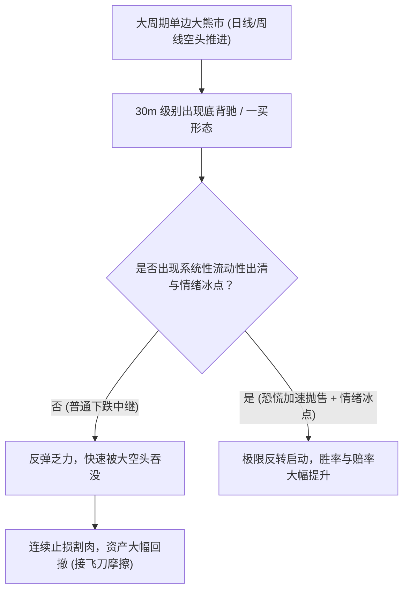
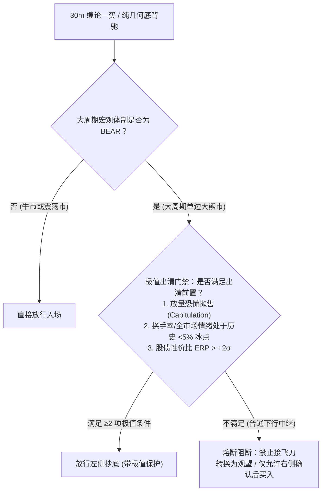
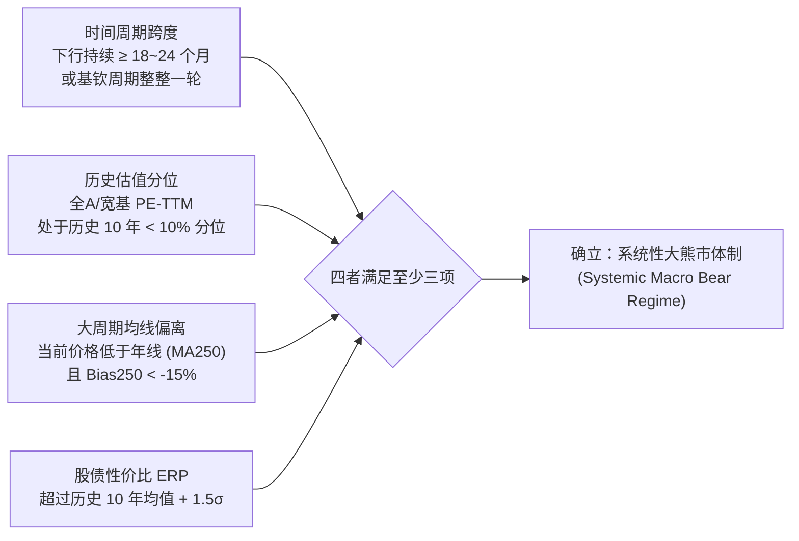
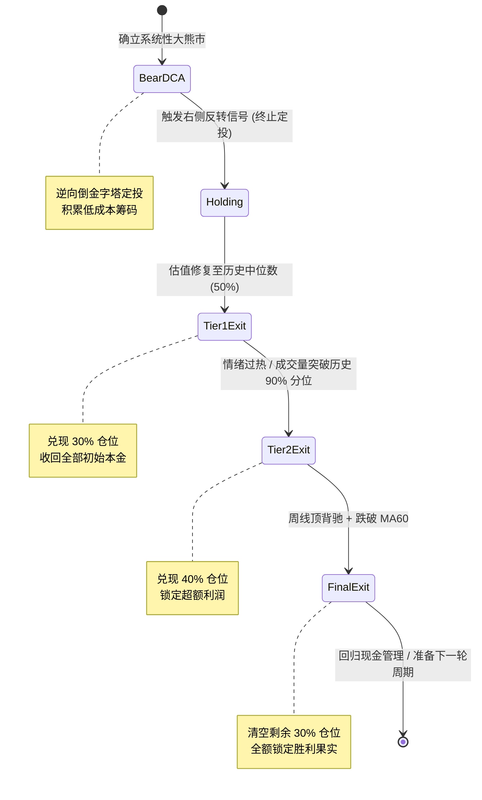
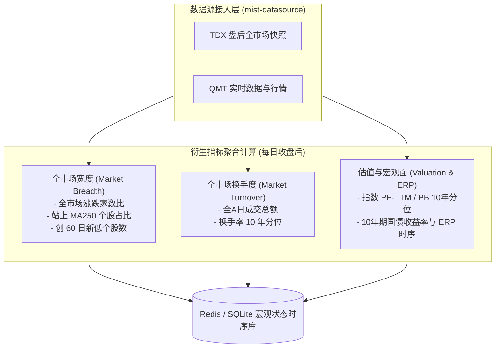
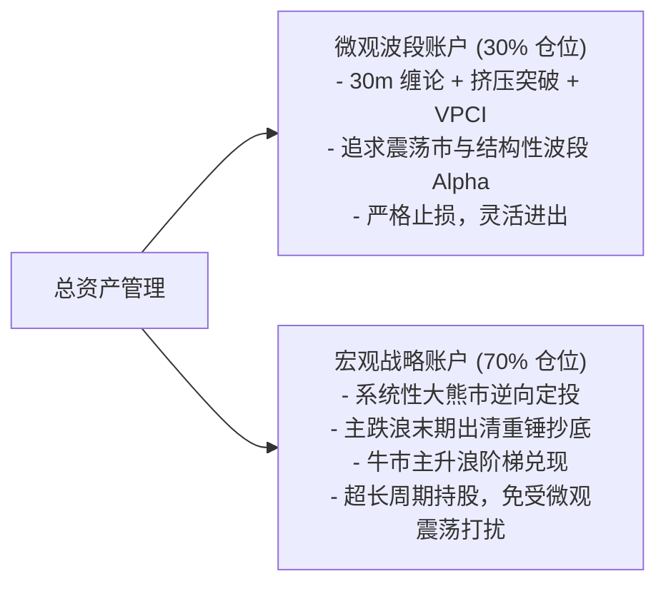

# 宏观大熊市极值择时与逆向定投持有架构设计

> **定位**：量化投资体系宏观大周期战略设计与决策树扩展方案  
> **状态**：架构方案与研究规划（Research & Architecture Blueprint）  
> **适用标的**：宽基指数（上证指数、沪深300、全A指数、科创50、创业板指等）与大资金宏观头寸管理  
> **相关代码路径**：
> - 策略决策树求值器：[`libs/strategy/src/decision-flow/`](file:///Users/moyui/sean/mist/mist/libs/strategy/src/decision-flow/)
> - 宏观体制与因果评估：决策流因子插件与风控门禁契约
> - 交易执行与经纪商：[`libs/strategy/src/execution/`](file:///Users/moyui/sean/mist/mist/libs/strategy/src/execution/)
> - 持仓状态机：[`libs/strategy/src/position/`](file:///Users/moyui/sean/mist/mist/libs/strategy/src/position/)

---

## 目录

1. [背景复盘与认知跃迁](#一背景复盘与认知跃迁)
2. [专题一：主跌浪末期极值择时体系（防止“接飞刀”）](#二专题一主跌浪末期极值择时体系防止接飞刀)
   - 2.1 机械形态在下行趋势中频繁失效的数学本质
   - 2.2 历史典型流动性踩踏与出清案例拆解
   - 2.3 极值出清的核心量化算子库
   - 2.4 决策树接入方案：防接飞刀的前置熔断门禁
3. [专题二：系统性大熊市逆向定投与波段主升架构](#三专题二系统性大熊市逆向定投与波段主升架构)
   - 3.1 大资金视角的战略转变：放弃微观噪音，拥抱大周期定投
   - 3.2 数学定义：什么是“系统性大熊市”？
   - 3.3 逆向价值定投执行模型（加权倒金字塔播种）
   - 3.4 右侧反转确立与牛市波段主升阶梯兑现
4. [量化与工程链路落地蓝图](#四量化与工程链路落地蓝图)
   - 4.1 数据层需求扩展（全市场宽度与衍生估值）
   - 4.2 插件与决策树拓扑扩展
   - 4.3 双账户解耦：微观波段仓 vs 宏观战略底仓
5. [总结与新线程思考指引](#五总结与新线程思考指引)

---

## 一、背景复盘与认知跃迁

### 1.1 微观 30m 缠论形态抓反弹在熊市中的痛点

在量化策略的实际回测与单步仿真中，单纯基于 30m 级别的因果几何结构（如底背驰、一买）在单边下跌趋势中抓反弹，极易出现严重的摩擦损耗与深度浮亏：

1. **大周期动量压制**：在大级别单边下行通道中，微观级别的底分型或小级别线段反弹，往往只是下跌中枢的中继震荡；一旦微观反弹无力（未能演变为三买或突破中枢上轨），空头会迅速顺应大趋势再次暴跌击穿前期低点，造成接连不断的止损。
2. **“假底”陷阱**：在缺乏宏观流动性与情绪配合的左侧盲目猜底，往往是“以为到了地板，其实还在半山腰”。



### 1.2 2024 年底脉冲点火（Pulse Ignition）的反思

针对 2024 年 9 月末大盘 5 个交易日暴涨 33%（900点）的罕见行情，前期曾尝试引入“脉冲突破点火”先手逻辑。然而经过深度分析与代码实践，该逻辑在宽基指数上并不合适：

1. **形态在因果律下无法成形**：在极速垂直暴涨中，K 线几乎是 90 度直线拉升，30m 级别全程无向下回调笔，缠论买卖点与挤压突破在数学上完全不触发；
2. **宽基指数 vs 个股板块的差异**：
   - **板块与个股**：脉冲爆发后通常伴随行业轮动、梯队扩散与回踩确认，脉冲先手适合个股追龙与突破抓取；
   - **宽基指数**：指数作为全市场加权平均，极少出现此类垂直脉冲（10年一遇）；盲目为指数增加脉冲追高逻辑，极易在震荡市或假突破中追在最高点。
3. **破局之策**：对付指数级别的十年一遇超级反转，最有效且胜率最高的打法**绝不是在暴涨中追入，而是在前期系统性大熊市中通过大周期低位逆向定投积累低成本筹码，坐享脉冲式拉升带来的主升浪红利**。

---

## 二、专题一：主跌浪末期极值择时体系（防止“接飞刀”）

### 2.1 机械形态在下行趋势中频繁失效的数学本质

- **动量与惯性定律**：价格下行的本质是资金供需严重失衡。微观 30m 结构的笔/段转折仅代表局部买卖盘的微弱抵抗，若上层卖压（筹码止损盘、被动平仓盘）未被彻底宣泄，局部的多头反抗会被迅速击溃。
- **左侧拐点成立的前提**：真正的左侧底绝非悄无声息地到来，而是必须经历**流动性休克、恐慌踩踏、带血筹码换手**的“最终出清”（Capitulation）。

### 2.2 历史典型流动性踩踏与出清案例拆解

| 历史时期 | 核心危机诱因 | 出清特征与盘面表现 | 反转前夕的极值特征 |
| :--- | :--- | :--- | :--- |
| **2018 年底**<br>(2440点历史底) | 股权质押危机连环爆仓、中美贸易摩擦 | 市场全天成交额缩减至 2000 亿极值冰点；全市场 80% 股票跌破质押平仓线；垃圾股连续一字跌停。 | **缩量极致磨底后突发放量长阳**；纾困基金与政策托底出台；全市场换手率降至历史 1% 极值位。 |
| **2024 年初**<br>(2635点深蹲底) | 雪球产品集中敲入、量化 DMA 杠杆平仓、微盘股踩踏 | 股指期货深贴水超 30%；微盘股指数连续单日跌超 8%；千股跌停与流动性枯竭；融券与两融平仓盘砸盘。 | **主跌浪末期恐慌放量加速抛售**；国家队集中申购沪深300及中证500/1000 ETF 托底；情绪崩溃至历史绝对冰点。 |
| **2015 年下半年**<br>(配资去杠杆底) | 场外非法配资高杠杆强平、流动性抽水 | 连续大面积千股跌停；停牌潮躲避流动性清算；两融余额断崖式萎缩。 | **救市资金真金白银进场承接**；大盘连续出现深幅放量下影线；换手充分出清。 |

### 2.3 极值出清的核心量化算子库

要识别“真正的反转底”而非“半山腰的飞刀”，必须引入全市场情绪与流动性极值算子：

#### 算子 1：全市场流动性与换手衰竭指标 (Market Turnover Washout)
- **定义**：全市场单日成交额 / 自由流通市值（换手率）。
- **极值判定**：
  $$\text{TurnoverRatio} \le \text{Percentile}_{10Y}(5\%)$$
  例如：当全 A 总成交额从万亿缩至 4500~5000 亿，换手率处于过去 10 年前 5% 极低分位时，表明多空双方已精疲力竭，浮动筹码沉淀。

#### 算子 2：主跌浪末期放量加速恐慌抛售 (Panic Capitulation Volume)
- **定义**：指数创出新低的同时，成交量相较前 5 日均量显著放大（$V > 1.8 \times MA(V, 5)$），且日内波动率（ATR）突破过去 250 日 95% 分位数。
- **物理意义**：被动平仓盘（融资爆仓、质押违约、基金止损线强平）涌出，带血筹码在低位被长线强手资金接盘，形成经典的“恐慌出清量（Selling Climax）”。

#### 算子 3：市场宽度与超卖极值 (Market Breadth Extreme)
- **年线上方股票占比**：全市场收盘价高于 MA250 的个股占比 $< 10\%$（极度恶劣熊市甚至 $< 5\%$）；
- **RSI/超卖极值**：指数周线 RSI(14) 跌破 25，或全市场连续 3 日下跌家数占比 $> 85\%$。

#### 算子 4：宏观股债性价比溢价 (Equity Risk Premium, ERP)
- **定义**：$ERP = \frac{1}{PE_{TTM}} - 10Y_{\text{国债到期收益率}}$
- **极值判定**：$ERP \ge \mu_{10Y}(ERP) + 2\sigma$（处于历史 10 年均值上方 2 个标准差，即 97.7% 分位点），表明股票资产隐含回报率相对无风险利率具备压倒性优势。

### 2.4 决策树接入方案：防接飞刀的前置熔断门禁

在决策流树（Decision Flow Tree）中，原有的 30m 买点节点不能直接暴露在熊市中，必须增设前置守门节点：



> [!IMPORTANT]
> **刚性防飞刀铁律**：在大周期熊市中，**无恐慌极值不抄底**。没有出现带血筹码集中出清前，任何微观级别的一买、类一买、底背驰一律按“反弹诱多”处理，直接予以短路阻断！

---

## 三、专题二：系统性大熊市逆向定投与波段主升架构

### 3.1 大资金视角的战略转变：放弃微观噪音，拥抱大周期定投

在大周期系统性深幅熊市（持续阴跌 3~5 年、估值降至冰点）中，最致命的操作往往不是“不操作”，而是“频繁试图在 30m 级别做波段”：
1. **频繁磨损**：在存量博弈和缩量阴跌市场中，电风扇轮动极其迅速，频繁短线交易会被印花税、佣金以及假突破持续抽血；
2. **大资金容量限制**：大资金无法在右侧突破暴拉的一瞬间建仓完毕（冲击成本巨大）；
3. **最优打法**：**“战略低位播种 + 熬过极度悲观 + 均线/情绪牛市反转波段主升兑现”**。

### 3.2 数学定义：什么是“系统性大熊市”？

不能把 2~3 个月的回调误判为系统性大熊市。真正的系统性大熊市必须满足以下四重过滤条件：



### 3.3 逆向价值定投执行模型（加权倒金字塔播种）

一旦状态机确立进入 `Systemic Macro Bear Regime`，系统自动挂起高频微观交易，启动**逆向价值定投引擎（Contrarian Value DCA Engine）**：

#### 1. 定投周期与节奏
- **基准频率**：按周或按双周执行（避免日内随机扰动）；
- **总播种区间设计**：预备资金划分为 $N = 24 \sim 36$ 份（保证可支撑 1.5 ~ 2 年的单边磨底）。

#### 2. 估值偏离度动态加码因子
非固定金额定投，而是根据**越低估越加码**的倒金字塔原则：
$$Amount_t = BaseAmount \times (1 + \alpha_{val} \times (1 - \text{Percentile}_{PE}) + \beta_{panic} \times \mathbb{I}_{crash})$$

- $\text{Percentile}_{PE}$：当前估值在过去 10 年的分位数（0.0 ~ 1.0）；
- $\mathbb{I}_{crash}$：恐慌加速指示器。当周若出现单周跌幅 $> 4\%$ 或日内千股跌停，当期金额追加 50%；
- **效果**：在 10% 估值分位时以 1.5 倍基准买入，在 3% 估值分位极端下杀时以 2.0 倍基准买入，使得整体持仓成本极度贴近历史绝对底部的加权重心。

```
成本分布示意：
价格高位 (估值 15%~20%)  ├── 1.0x 基础仓位
价格中位 (估值 8%~15%)   ├──── 1.3x 强化仓位
价格极值 (估值 < 5% 冰点) └──────── 2.0x 重锤爆买 (筹码密集区)
--------------------------------------------------------
最终综合持仓成本线 ≈ 历史最低点上方 5%~8% 的极低筹码防线
```

### 3.4 右侧反转确立与牛市波段主升阶梯兑现

定投不是“死拿不放”，而是为了在牛市主升浪中享受超级溢价。兑现必须依托客观的右侧指标，杜绝主观臆测。



#### 阶梯 1：右侧反转确立（终止定投，转入全仓主升持有）
- **触发条件**：
  1. 日线放量站上年线（MA250），且 20 日均线与 60 日均线形成黄金交叉；
  2. 宏观体制插件 `ShanghaiRegimePlugin` 状态正式由 `REGIME_BEAR` 跃迁为 `REGIME_BULL`；
- **执行动作**：停止定投计划，关闭买入通道，持仓状态机标记为 `LONG_BULL_RIDE`（主升浪长持）。

#### 阶梯 2：第一级止盈（收回本金，锁定安全垫）
- **触发条件**：宽基指数 PE-TTM 估值分位数从冰点回升至**历史 50% 中枢（估值修复完成）**；
- **执行动作**：平仓卖出总持仓的 **30%~35%**（通常已能覆盖全部定投本金，剩余持仓完全由利润构成，零心理负担）。

#### 阶梯 3：第二级止盈（情绪过热与泡沫化兑现）
- **触发条件**（满足任意两项）：
  1. 全市场单日成交额达到历史 95% 分位数（如全 A 成交突破 2 万亿以上且持续放量换手）；
  2. 全市场处于年线上方股票占比 $> 85\%$；
  3. 股债性价比 ERP 跌破历史 10% 分位数（股票吸引力已被极度透支）；
- **执行动作**：再兑现 **40%** 仓位，仅保留 30% 利润底仓跟踪极端主升浪。

#### 阶梯 4：终局清仓（周期见顶与防守回撤）
- **触发条件**：
  - 周线级别出现标准缠论顶背驰（或大级别死叉）；
  - 价格有效跌破周线 MA20 或日线 MA60；
- **执行动作**：清空剩余仓位，锁定整轮大牛市全部战果，重归现金管理（理财/短融），耐心等待下一个 3~5 年周期的系统性出清。

---

## 四、量化与工程链路落地蓝图

### 4.1 数据层需求扩展（全市场宽度与衍生估值）

目前系统核心依赖单个标的的 OHLCV 序列。要落地上述两套大周期体系，需在数据层（`mist-datasource`）增加以下聚合与衍生指标流：



### 4.2 插件与决策树拓扑扩展

在 `libs/strategy/src/decision-flow/` 架构下，未来可新增两个专业因子/门禁插件：

1. **`plugin.macro.panic-capitulation`（恐慌抛售与极值出清插件）**：
   - 作为左侧一买/底背驰节点的**前置 Guard 节点**；
   - 内部维护全市场换手、恐慌放量与 ERP 分位数；
   - 仅在极值激活时输出 `action: 'BUY'` 放行，平时输出 `NEUTRAL` 阻断飞刀。

2. **`plugin.strategy.macro-dca-engine`（大熊市定投调度插件）**：
   - 识别大熊市与估值分位数；
   - 负责发出周期性定投增量调仓指令（`action: 'BUY', targetAllocation: ...`）；
   - 输出阶梯止盈信号。

### 4.3 双账户解耦：微观波段仓 vs 宏观战略底仓



> [!TIP]
> **物理分仓是战胜人性的最好方式**：
> 将短线交易与长线底仓混在同一个账户中，往往会导致“定投的便宜筹码在刚反弹 5% 时就被短线止盈卖飞”，或者“短线追高被套后自欺欺人变成长期套牢”。通过独立的 `PositionStateMachine` 实例实现账户隔离，方能兼顾波段灵活性与大周期财富效应。

---

## 五、总结与新线程思考指引

### 核心结论摘要

1. **接飞刀择时的关键不在几何，而在情绪与流动性出清**：
   微观几何（30m）在单边大熊市中没有自支撑能力；只有叠加“恐慌抛售加速 + 换手冰点 + 股债极值”时，微观买点才有极高胜率。
2. **脉冲点火不适合宽基指数追涨**：
   指数垂直脉冲是小概率事件，追高期望极差；指数的最优策略是**在前期大熊市中通过逆向定投持有至牛市脉冲反转**。
3. **大熊市是财富再分配的播种期**：
   通过倒金字塔估值加权定投，彻底化解择时焦虑；再通过右侧年线确认与阶梯估值/情绪兑现模型，完成闭环。

---

### 新线程思考建议（供后续讨论启动）

在新线程中深入推进本架构时，可优先聚焦以下三大核心切入点：

1. **数据源采集与落盘设计**：
   - 如何通过 Python/TDX 在每日收盘后以极低成本自动计算并落盘全市场估值中位数、站上年线个股比例与换手率分位？
2. **定投资金曲线仿真验证**：
   - 使用 2011~2014 年、2018 年、2021~2024 年真实上证指数/沪深300历史数据，验证纯固定定投 vs 估值偏离倒金字塔定投的综合持仓成本差与最大浮亏对比。
3. **阶梯止盈敏感度分析**：
   - 对比“估值 50% 分位止盈 30%”与“突破年线止盈”对最终夏普比率和资金复合增长率的影响。

---

## 六、现代 A 股回测定界（2016 至今）与时间衰减自迭代架构 (2026-10-29 核心演进)

### 6.1 历史纪律定界：以 2016 为主战场，远端大牛市退居辅助

1. **拒绝“拉平 10 年/20 年平铺回测”的历史刻舟求剑**：
   - 2016 年以前的 A 股（2006-2007 股权分置改革大牛市、2014-2015 场外高杠杆配资疯牛与千股跌停），处于无全面注册制、无量化主导、无融券与衍生对冲的蛮荒散户杠杆时代；
   - 若将 10 年（2,500 根）甚至 20 年历史无差别平铺纳入回测，会导致样本被杠杆疯牛的极值（如 2015 股灾 CYS13 打到 -20%）严重污染，从而钝化现代行情的超跌敏感度。
2. **主次回测定界原则**：
   - **主战场（核心回测与参数自迭代基准）**：**2016 年小牛市（熔断 2638 点见底）至今（2016~2026）**。该阶段完整涵盖机构化、外资进出、量化多空、注册制推进、微盘雪球生态与近端结构性牛熊分化；
   - **辅助测试（极端压力测试）**：2007 与 2015 两波超级大牛市及股灾，**仅作为极度恶劣流动性出清时的压力测试辅助校验**，绝不作为常态化自迭代参数的标准输入。

### 6.2 近端结构性行情主导与时间衰减加权（Temporal Decay）

1. **结构性牛市的微观主导性**：
   - 现代 A 股不再是“鸡犬升天”的全市场普涨，而是呈现高频的“结构性牛市”特征（如 2019-2021 核心资产茅指数、2021-2022 新能源、2023-2024 高股息/微盘分化、2024.9 脉冲行情）；
   - 距离当前越近的结构性行情，对当前的筹码沉淀、资金偏好与波动率分布影响越大；距离越远的历史数据，影响因子应当加速衰减。
2. **自迭代分位数的时间衰减数学模型**：
   彻底废弃传统等权重全样本直方图，引入指数半衰期时间衰减加权（Exponential Time Decay）：
   $$w_i = e^{-\frac{T - t_i}{\tau}}$$
   其中 $\tau$ 为半衰期衰减参数（如 $\tau \approx 250 \sim 500$ 根交易日，即 1~2 年半衰期）。
   在计算 $CYS13$ 历史经验分位数 $P_5$ 与 $P_2$ 时，近期样本具有决定性权重，远期历史仅作为微弱背景先验，实现模型参数对现代结构性行情的敏捷自迭代。

### 6.3 差异化分层标尺体系：指数 vs 板块 vs 个股

由于资金生态、护盘机制与微观流动性存在本质差异，三大层级不能共用同一套参考标准：

| 层级标的 | 资金生态与驱动逻辑 | 极值与波动特征 | 自迭代衰减半衰期 $\tau$ | 自适应参考标准 |
| :--- | :--- | :--- | :--- | :--- |
| **宽基指数**<br>(000001 / 000300 等) | 受国家队护盘工具（上证50/沪深300权重）与宽基 ETF 被动资金钝化 | 极值偏收敛（通常 $P_2 \approx -6\% \sim -7\%$），易被权重护盘掩盖真实生态 | $\tau \approx 500$ 日 (~2年)<br>窗口上限 750~1000 日 | 聚焦宏观大底识别与市场失真剪刀差 ($Spread = IndexCys - MarketAvgCys$) |
| **行业/板块**<br>(申万一级/中信行业/ETF) | 受产业政策、库存周期与机构抱团轮动主导，呈现结构性轮动牛熊 | 波动中等，但轮动分化剧烈，强者恒强或持续阴跌出清 | $\tau \approx 250 \sim 350$ 日 (~1~1.5年) | 聚焦行业筹码加速出清与板块相对强弱度量 |
| **个股标的**<br>(全A个股) | 受微观筹码分布、个股 Beta、业绩断层与微盘流动性支配 | 极值扩散大（低波蓝筹 $P_2 \approx -4\%$，高波科技 $P_2 \approx -12\%$） | $\tau \approx 250$ 日 (~1年)<br>窗口 500~750 日 (基钦周期) | 100% 依托个股专属加权分位数，严禁跨标的死板套用单一阈值 |


