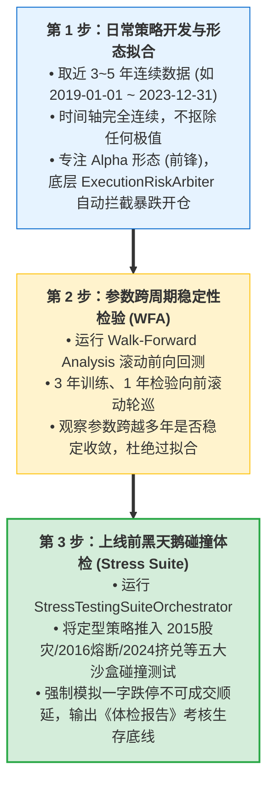

# A 股量化研究数据切分与日常开发实战标准操作规程 (SOP)

> **适用范围**：Mist 量化时序系统策略研发、因子挖掘、时序单步推演与回测验证  
> **核心原则**：保持全时序连续推进，坚决杜绝“手工截断/抠除极值”，双核正交风控兜底，压力沙盒防守体检。

---

## 一、 为什么绝对禁止“人工在时间轴里抠掉极值”？

在日常分析中，初学者常犯的严重错误是：*“把 2015 股灾或大跌月份从数据里删掉，只留下平稳月份来跑”*。本规程**绝对禁止**此类操作，原因如下：

1. **破坏技术指标的数学连续性（“缝合怪”灾难）**：
   - 缠论几何（分型、笔、线段、中枢）与经典指标（MA20/MA60、MACD、ATR、布林带）全部依赖**连续平滑的时间推移**；
   - 若将 2015 年 6 月 12 日（5178 点）直接与 8 月 27 日（2850 点）硬缝在一起，次日即是一条凭空产生、横跨两千余点的巨大伪跳空断崖。所有跨越该区间的均线平滑、MACD 面积及中枢判定当场崩溃，产出的完全是毫无意义的伪数据。
2. **剥夺风控系统在危机初期的实战感知力**：
   - 实盘暴跌在第一天截面上与普通健康回调并无二致；
   - 若人为抠除暴跌期，策略永远学不会“如何在下行早期果断刹车清仓”，实盘一旦遭遇真实调整便会习惯性死扛穿仓。

---

## 二、 A 股 35 年历史时序“黄金四分法”使用准则

```
1990 ────── 1996.12 ────── 2005.05 ────────────── 2023.12 ────── 2024 至今
  [ 绝对禁区 ]    [ 极低价值区 ]      [ 核心开发训练池 ]      [ 严格盲测集 ]
 (有毒数据，物理剔除) (老庄股时代，不看)   (现代全流通完整大牛熊)    (开发时绝对不看，最后大考)
```

| 时序区间 | 历史阶段特征 | 量化研发定界 | 实操准则 |
| :--- | :--- | :--- | :--- |
| **1990.12 ~ 1996.12** | 初创野蛮期：无涨跌停限制、实行 T+0、老八股极少样本 | **【有毒数据】** | **物理截断，绝对不碰**。<br>系统底层由 `DataSanitizationGuard` 刚性拦截，早于 1996-12-16 自动拒载。 |
| **1997.01 ~ 2005.04** | 制度初设与老庄股时代：非流通股占 2/3、庄家画线严重 | **【极低价值】** | **平时不建议使用**。<br>技术形态多为人造控盘骗线，缺乏现代机构化定价参考价值。 |
| **2005.05 ~ 2023.12** | 股权分置改革全流通至今：现代 A 股真正的基准原点 | **【核心开发与拟合池】** | **日常研发主力战场**。<br>包含 6124、1664、5178 等完整大牛熊，数据充沛且具备现代制度有效性。<br>★ **重点推荐取近 3~5 年（如 2019-2023）作为日常参数研发主窗口**（微观博弈生态最接近当下）。 |
| **2024.01 至今** | 全面注册制、量化微盘与外生博弈新范式 | **【严格样本外盲测集 (OOS)】** | **日常调参期间绝对不看**。<br>将其视为密封高考考卷，仅在策略完成前期开发定型后，作为最终检验泛化能力的盲测集。 |

---

## 三、 日常策略研发标准操作规程（SOP 三步走）



### 步骤 1：日常策略开发与形态拟合（只管进攻，风控交给裁决器）
1. **数据切片设定**：
   - 起止时间建议设为 `2019-01-01` 至 `2023-12-31`（约 1200 根日线 Bar）；
   - 数据必须保持自然连续，严禁人工做断点剔除。
2. **策略树编写**：
   - 专注于几何结构、形态突破与信噪比；
   - **不必担心 2024 年初暴跌把策略打穿**：系统底层的 `ExecutionRiskArbiter` 会在行情出现暴跌或流动性枯竭时自动一票否决（Veto）买单，并对持仓执行系统级生存清仓。

### 步骤 2：参数稳定性前向检验（WFA 步进验证）
1. 当在步骤 1 中找到一组看起来不错的形态参数后，**严禁直接上线**；
2. 启动 **Walk-Forward Analysis (WFA)**：
   - 设定窗口为“3 年训练、1 年测试”，从 2005 年开始自动向前滚动推进；
   - 检查参数在各年份之间的稳定性（PSI 指数）：如果参数忽大忽小，说明严重依赖局部运气，需重新收敛参数；若拼接出的样本外曲线平稳向上，方可放行。

### 步骤 3：上线前黑天鹅碰撞体检（Stress Testing Suite）
1. 汽车出厂前必须进行“百公里时速撞击水泥墙”的碰撞测试；
2. 运行 `StressTestingSuiteOrchestrator`：
   - 电脑自动将策略投放到 A 股五大极限沙盒（`CRASH_2015`、`CIRCUIT_2016`、`BEAR_2018`、`SQUEEZE_2024`、`PULSE_2024`）；
   - **强制开启制度残酷模拟**：如果遇到一字跌停，电脑绝对禁止按收盘价卖出，必须挂起为 `BLOCKED` 并顺延至打开跌停日，模拟真实流动性惩罚；
3. **查阅《极端压力测试体检报告（Stress Health Card）》**：
   - 检查 **Worst-Case Drawdown** 是否在可承受边界（如 < 15%）；
   - 检查 **Max Underwater Duration**（回撤潜伏期天数）；
   - 若评级为 `FRAGILE` 或 `FAIL`，**严禁修改买卖点参数**，而是调整底层风控裁决器的安全气囊灵敏度（如缩紧硬止损阈值或调低大盘暴跌一票否决警戒线）。

---

## 四、 核心原则速记卡

* **不剪辑**：时间序列必须纯天然连续，坚决不抠极值；
* **不前瞻**：1996 年底前有毒数据坚决不用，最近 1 年留作密封大考；
* **双核分工**：平时调参只管赚钱逻辑（Alpha），极端行情靠底层守门员（Arbiter）保命；
* **碰撞测试**：上线前必跑五大压力沙盒，撞墙不死方可实盘。
