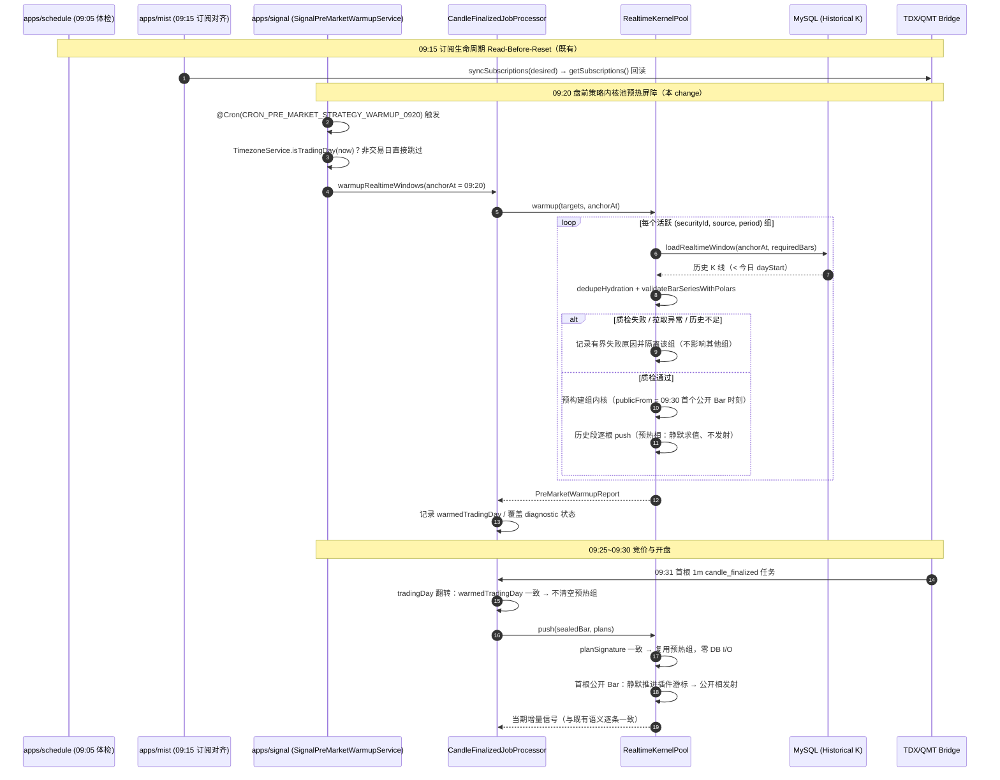

# Design: Pre-Market Strategy Kernel Pool Warmup and Timeline Governance

## 1. 架构全景与时序流转

### 1.1 盘前时间轴编排（09:05 ~ 09:31）



### 1.2 与既有统一内核语义的关系（三链路同构不受影响）

- 预热只是**把 buildGroup 从"开盘首根触发"提前到"09:20 主动触发"**，不改变
  内核 push 语义：`timestamp < publicFrom` 预热相静默、`>= publicFrom` 公开相发射。
- 内核的 `prewarmStatus`（`full`/`partial`/`empty`）判定逻辑不变：预热组在
  09:20 完成历史段 push 后，`preWarmActual` 即已就绪；首根公开 Bar 触发一次
  静默求值，将插件单调游标推进到预热结束时刻——这正是统一内核"杜绝历史形态点
  在公开相首根倾泻发射"的既有设计，本 change 只是让它提前发生。
- 三链路同构门禁（`strategy-pipeline-homogeneity.guard.spec.ts`）不新增路径：
  实时链路仍是 `RealtimeKernelPool → 内核`，只是池的组由预热而非懒加载建立。

## 2. 核心设计细节

### 2.1 调度常量收口（`@app/timezone`）

```typescript
/** 09:20 Asia/Shanghai on exchange trading days (Monday - Friday). Pre-market strategy kernel pool warmup barrier. */
export const CRON_PRE_MARKET_STRATEGY_WARMUP_0920 = '0 20 9 * * 1-5';
```

`apps/signal` 侧编排服务：

```typescript
@Injectable()
export class SignalPreMarketWarmupService {
  constructor(
    private readonly registry: SignalRegistryService,
    private readonly processor: CandleFinalizedJobProcessor,
    private readonly timezoneService: TimezoneService,
    private readonly clock: Clock,
  ) {}

  @Cron(CRON_PRE_MARKET_STRATEGY_WARMUP_0920, { timeZone: ASIA_SHANGHAI_TIMEZONE })
  async handlePreMarketWarmup(): Promise<void> {
    const now = this.clock.now();
    if (!(await this.timezoneService.isTradingDay(now))) return;
    await this.processor.warmupRealtimeWindows(now); // 内部捕获一切异常，不抛出
  }
}
```

### 2.2 `RealtimeKernelPool.warmup`（`libs/signal/src/runtime/realtime-kernel-pool.ts`）

```typescript
export interface PreMarketWarmupTarget {
  readonly securityId: number;
  readonly source: StrategyRealtimeSource;
  readonly period: number;
  readonly plans: readonly RealtimeStrategyExecutionPlan[];
}

export type PreMarketWarmupFailureReason =
  | 'insufficient_bars'
  | 'timestamp_reversed'
  | 'invalid_price'
  | 'price_boundary_violation'
  | 'contains_null_or_nan'
  | 'query_failed';

export interface PreMarketWarmupReport {
  readonly total: number;
  readonly succeeded: number;
  readonly skipped: number;
  readonly failed: number;
  readonly failedTargets: readonly {
    readonly target: RealtimeWindowGroupIdentity;
    readonly reason: PreMarketWarmupFailureReason;
    readonly message: string;
  }[];
}

export class RealtimeKernelPool {
  /**
   * 盘前主动预热：为每个目标预构建组内核。
   * - 幂等：planSignature 一致且已预热的组直接跳过（skipped）。
   * - publicFrom = 首个预期公开 Bar 时刻（合成锚 Bar，见 2.3）。
   * - 单目标失败隔离，绝不抛出。
   */
  async warmup(
    targets: readonly PreMarketWarmupTarget[],
    anchorAt: Date,
  ): Promise<Readonly<PreMarketWarmupReport>>;
}
```

实现要点：

1. 对每个 target 计算 `requiredBars = max(plans.map(p => p.requiredBarCount))`
   与 `planSignature`；若组已存在且签名一致 → `skipped`。
2. `loadRealtimeWindow({ anchorAt, requiredBars, ... })` 拉取历史段
   （`anchorAt = 09:20`，适配器只返回 `< 今日 dayStart` 的历史 + 今日已封存段，
   09:20 时今日段恒空 → 纯历史，语义干净）。
3. `dedupeHydration(bars, anchorBar)` 复用既有去重（冲突身份仍抛错 → 归入
   `query_failed` 隔离）。
4. `validateBarSeriesWithPolars(bars, minRequiredBars)` 质检，失败归入有界 reason。
5. 预构建组内核：以合成锚 Bar 走既有 `buildGroup` 路径（等价"路径复刻"，
   不新增第二条构建逻辑），历史段逐根 `kernel.push`（全部落在预热相）。

### 2.3 `publicFrom` 合成锚 Bar 语义（关键决策）

- 懒加载路径的 `publicFrom` = 触发 hydration 的当根 Bar 时刻。预热路径没有真实
  触发 Bar，需构造**合成锚 Bar**：
  - `timestamp` = 当日 09:30（`anchorAt` 所在交易日的 session 起点，
    `MORNING_START_MIN` 对齐），type `complete`，OHLC 取历史窗口最后一根收盘价
    延展（纯占位，永不进入窗口——`dedupeHydration` 以 `timestamp < anchor` 过滤，
    合成锚只作为 `publicFrom` 与 push 守卫基准）。
  - 语义收益：历史段 100% 落在预热相（`< 09:30`），首根真实公开 Bar（09:30/09:31
    桶）触发公开相，与懒加载路径的开盘行为逐条一致。
- 边界：若当日首根封存 Bar 时间戳早于 09:30（异常早报），内核公开相判定仍以
  时间轴为准，不会错误发射历史点；该情形由既有 `out_of_order_trigger_discarded`
  与交易日校验守卫，不在本 change 扩展。
- 跨日守卫：`CandleFinalizedJobProcessor` 现有翻转分支对
  `cursors`/`periodBuilder`/`evaluation` 三件套整体清空。预热语义要求：
  - `cursors`（封存游标）与 `periodBuilder`（当日 1m→多周期聚合）**照常清空**，
    预热不涉及这两者状态；
  - `evaluation`（内核池）仅当"当前交易日 ≠ 预热锚定交易日"时才清空；
    若当日 09:20 已成功预热（`warmedTradingDay === tradingDay`），翻转分支
    跳过 `evaluation.reset()`，保留预构建组内核。
  - `warmedTradingDay` 在 `warmupRealtimeWindows` 成功后写入；注册表重建
    （`retainGroups` 收缩）与预热刷新保持既有对齐语义，无需额外处理。

### 2.4 Polars 向量质检（`libs/market-data/src/projection/bar-series-integrity.ts`）

```typescript
export type BarSeriesValidationOutcome =
  | { readonly valid: true }
  | {
      readonly valid: false;
      readonly reason: Exclude<PreMarketWarmupFailureReason, 'query_failed'>;
      readonly detail: string;
    };

export function validateBarSeriesWithPolars(
  bars: readonly StrategyBar[],
  minRequiredBars: number,
): BarSeriesValidationOutcome;
```

列式检查（`nodejs-polars`，与 `libs/indicators` Rust 底座一致）：

1. `bars.length < minRequiredBars` → `insufficient_bars`；
2. `pl.all().isNull().any()` → `contains_null_or_nan`（volume/amount 允许 null，
   剔除出检查列——接口既有语义 `volume: string | null`）；
3. `timestamp.diff().slice(1).lessThanEquals(0).any()` → `timestamp_reversed`；
4. 价格列（open/high/low/close）负值 → `invalid_price`；
5. `high < low` → `price_boundary_violation`。

- 纯函数、无 I/O、不常驻 DataFrame（质检后即 GC）；放 `libs/market-data`
  （纯边界库，无 `@app/*` 运行时依赖，符合 libs 分层）。
- `minRequiredBars` 取 `Math.min(requiredBars, 1)` 之外的实际语义值：预热要求
  **历史段足够支撑内核窗口预算**，因此取 `requiredBars`（不足归
  `insufficient_bars`，开盘走懒加载兜底时同缺同败，行为可预期）。

### 2.5 双重触发与幂等

1. **09:20 定时屏障**：全量活跃目标一次 `warmup`；交易日判定失败/非交易日跳过。
2. **事件联动**：`reconcileRegistry` 后对新出现或扩容的目标异步补热（同一
   `warmup` 入口，幂等跳过已就绪组）；09:20 前注册表未就绪时事件触发兜底。
3. **幂等键**：`(securityId, source, period)` + `planSignature`；注册表版本升级
   （`versionId` 变化 → 签名变化）在懒加载路径本就会触发组重建，预热路径与
   之对齐（签名不一致时重建，等于"预热刷新"）。

### 2.6 失败隔离与可观测性

- **单组故障隔离**：`query_failed`/质检失败只记录 warning 日志（有界 reason：
  `PREWARM_FAILED`、`DATA_INTEGRITY_ANOMALY`），累加 `failed`，绝不抛出、
  绝不影响其他组、绝不让服务 unready。
- **开盘退化**：预热失败的组在首根 Bar 到达时走既有懒加载（`buildGroup`），
  行为与现状一致。
- **健康暴露**（`SignalHealthVo` 新增区块）：

```typescript
preMarketWarmup: {
  state: 'off' | 'ready' | 'partial' | 'error';
  warmedAt: string | null;          // 最近一次预热完成时刻（ISO）
  anchorTradingDay: string | null;  // 预热锚定交易日 YYYYMMDD
  total: number;
  succeeded: number;
  skipped: number;
  failed: number;
  lastFailureCode: PreMarketWarmupFailureReason | null;
};
```

### 2.7 质量门禁合规性审查

- **命名**：`securityId`/`source`/`period`/`anchorAt` canonical 词汇；时间统一
  `@app/timezone` `Asia/Shanghai`；不引入无作用域 `ready`。
- **内存边界**：预构建组容量 = `requiredBars`（内核 `trimWindow` 既有约束），
  预热不产生额外常驻结构；报告对象 `Object.freeze`。
- **既有门禁不改**：`dev-server-boundary` / `homogeneity` / `dual-timestamp`
  三守卫语义不变；新代码不触碰 dev-server 与回测路径。
- **open handle**：cron 服务随 `@nestjs/schedule` 既有模式注册/销毁，无额外
  timer 泄漏。

## 3. 验证计划

1. **单元测试**：
   - `bar-series-integrity.spec.ts`：五类 reason 各自触发路径 + 通过路径；
     volume/amount null 不误杀。
   - `realtime-kernel-pool.spec.ts`（增量）：`warmup` 成功预构建、`planSignature`
     幂等跳过、质检失败隔离、拉取异常隔离；预热后首根公开 Bar push 发射行为与
     懒加载路径逐条一致（对照断言）。
   - `signal-pre-market-warmup.service.spec.ts`：交易日触发/非交易日跳过/异常吞掉。
   - `candle-finalized-job.processor.spec.ts`（增量）：`warmedTradingDay` 跨日
     守卫——预热后当日首根不清空组；无预热时行为与现状一致。
2. **集成断言**：
   - 模拟 09:20 预热 → 09:31 首根封存 Bar push，断言 `kRepository.find` 调用
     次数为 0（零首根 DB I/O）且信号与无预热路径一致。
   - 健康端点透出 `preMarketWarmup` 区块。
3. **门禁**：
   - 三大架构守卫 + `pnpm -C mist typecheck` + `pnpm -C mist test:ci`。
   - `openspec validate --all --strict`。
