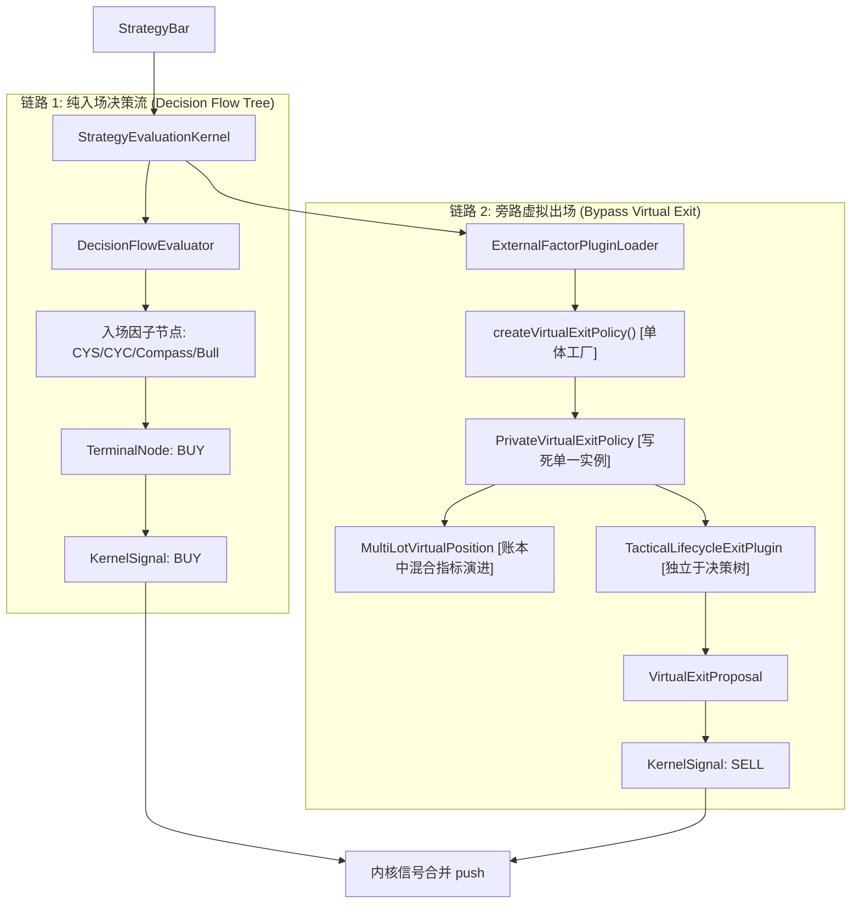

# 技术方案设计：出场插件同构化与决策树统一收敛 (Design)

## 一、架构设计总览 (Architectural Topology)

### 1. 现状架构 (As-Is: 旁路分离架构)


### 2. 目标架构 (To-Be: 决策树终极收敛架构)
```mermaid
flowchart TD
    Bar[StrategyBar] --> Kernel[StrategyEvaluationKernel]
    
    subgraph UniformPipeline["统一决策树求值 (Unified Decision Flow Tree)"]
        Kernel --> InjectContext["装配上下文: 注入 series.* 与只读持仓快照 position.virtual"]
        InjectContext --> RootBranch{"BranchNode: position.virtual.state"}
        
        RootBranch -->|FLAT / 未持仓| EntryFlow["入场决策子树 (Entry Sub-tree)"]
        EntryFlow --> EntryPlugins["入场因子: 缠论买点/超跌/突破/共振"]
        EntryPlugins --> TerminalBuy["TerminalNode: BUY"]
        
        RootBranch -->|HOLDING / 已持仓| ExitFlow["出场决策子树 (Exit Sub-tree)"]
        ExitFlow --> ExitPlugins["同构出场因子 (category='EXIT'):<br/>1. 破位止损<br/>2. 成本线动态止盈<br/>3. 斐波空间止盈<br/>4. 微观极值逃顶"]
        ExitPlugins --> TerminalSell["TerminalNode: SELL"]
    end

    TerminalBuy --> UnifiedSignals[增量信号流 KernelSignal]
    TerminalSell --> UnifiedSignals
    
    subgraph PluginRegistry["外部插件统一动态发现 (Plugin Discovery)"]
        PrivateRepo["外部私有策略工程 (或外部插件)"] -->|导出 FactorPlugin[]| Loader[ExternalFactorPluginLoader]
        Loader -->|统一注册| Reg["FactorPluginRegistry (平权管理)"]
        Reg -.->|按 pluginId 提供实例| EntryPlugins
        Reg -.->|按 pluginId 提供实例| ExitPlugins
    end

    subgraph PureLedger["客观物理持仓账本 (Pure Physical Ledger)"]
        UnifiedSignals --> AdvanceLedger["虚拟账本推进 (先结算出场，再建立进场新批次)"]
        AdvanceLedger --> PureTracker["MultiLotVirtualPosition (纯净物理时钟/价格/权重)"]
        PureTracker -.->|每根 Bar 产出只读快照| InjectContext
    end
```

---

## 二、关键技术细节与契约设计

### 1. 契约同构：出场插件作为标准 `FactorPlugin` 与 `ExitPlugin`
- 出场插件直接实现 `ExitPlugin` 与 `FactorPlugin` 接口，零继承直接实现，专职实现 `evaluateExit`（异步 `evaluate` 直接复用）：
  ```typescript
  export class AtrDefenseExitPlugin implements ExitPlugin, FactorPlugin {
    public readonly id = 'plugin.exit.atr_defense';
    public readonly name = '自适应ATR防守与跟踪止损插件';
    public readonly category = 'EXIT' as const;
    public readonly version = '1.0.0';

    public evaluateExit(
      context: FactorContext,
      params?: Record<string, unknown>,
    ): FactorOpinion {
      // 1. 通过纯函数工具提取符合 A股 T+1 (holdingBars > 0) 的可平仓批次与当根收盘价
      const lots = getAvailableExitLots(context);
      const close = resolveExitCurrentClose(context);
      if (!close || lots.length === 0) {
        return { action: 'NEUTRAL', confidence: 0, reason: '无满足T+1条件的活跃持仓或当前价格缺失' };
      }

      // 2. 依次判决自适应 ATR 防守与动态追踪止损...
      for (const lot of lots) {
        if (lot.defensePrice > 0 && close < lot.defensePrice) {
          return buildExitOpinion({
            lot,
            exitKind: 'STRUCTURAL_BREAKDOWN',
            triggerPrice: close,
            reason: `假底结构破位止损：日线收盘跌破专属起涨防守线`,
            ownerPluginId: this.id,
            metricValues: { defensePrice: lot.defensePrice, close },
          });
        }
      }
      return { action: 'NEUTRAL', confidence: 0, reason: '未触发 ATR 防守或移动止损条件' };
    }

    public async evaluate(
      context: FactorContext,
      params?: Record<string, unknown>,
    ): Promise<FactorOpinion> {
      return this.evaluateExit(context, params);
    }
  }
  ```

### 2. 上下文注入范式 (Context Injection)
- 在每根 Bar 执行决策树求值前，内核或调度层统一执行上下文装配：
  1. 读取多周期 K 线序列注入 `series.<period>`；
  2. 读取辅助特征/指标注入 `indicator.<name>`；
  3. 读取虚拟多批次账本当前状态，生成深度不可变的只读快照 `VirtualPositionContext` 并注入 `position.virtual`；
- 严禁出场插件直接持有可变账本实例，出场插件只对不可变快照做纯数学因果判定。

### 3. 决策树节点编排扩展
- **分支节点分流**：
  在策略定义中，根节点使用 `BranchNode`：
  ```json
  {
    "id": "node.root.position_branch",
    "type": "BRANCH",
    "name": "多空持仓分流",
    "condition": {
      "attributeKey": "position.virtual.state",
      "operator": "eq",
      "value": "HOLDING"
    },
    "branches": {
      "true": "node.exit.composite_guard",
      "false": "node.entry.resonance_consensus"
    }
  }
  ```
- **出场共识/门禁节点**：
  `node.exit.composite_guard` 挂载 `plugin.tactical.lifecycle_exit`（或细分的出场插件组合）；
  当插件返回 `action: 'SELL'` 时，流向 `TerminalNode(action: 'SELL')`；
  未触发时返回 `NEUTRAL`，决策树自然终止静默，不发射信号。

### 4. 外部加载器与注册表全平权
- `ExternalFactorPluginLoader.loadPlugins()` 自动扫描候选目录，不再区分入场或出场；
- 所有满足 `isFactorPlugin` 契约的插件统一注册进 `FactorPluginRegistry`；
- 决策树无论在入场分支还是出场分支引用 `pluginId`，均通过 `registry.get(pluginId)` 统一获取并执行。

### 5. 账本 Map 升级、Lot 瘦身与信号组合工具化
- **`Set` 升级为 `Map` (自然反查)**：
  - 将原 `activeEntryIds = new Set<string>()` 升级为 `activeEntries = new Map<string, EntryRecord>()`；
  - 以买入信号 ID（如 `signalId`）为 Key，存储该笔买入的核心事实（`entryPrice`, `entryTime`, `defensePrice`, `holdingBars`, `peakClose`）；
  - 出场时通过 `matchedSignalId` 直接在 Map 中反查买入记录，天然闭环因果追溯，消灭任何外部 I/O 依赖；
- **剥离沉重 Lot 体系**：
  - 彻底删除 `VirtualPositionLot` 的槽位配额（`maxActiveLots: 2`）、UUID 生成器与 `0.5` 权重拆分；
  - 账本彻底纯化，仅维护客观物理时钟（`holdingBars`）与最高价（`peakClose`）；
- **信号/提案组合独立工具化 (对齐今早的 Context 组装器)**：
  - 对齐今早落地的 `VirtualPositionContextAssembler`（负责输入装配），提取专职的 `VirtualExitProposalAssembler`（负责输出组合）；
  - 将 Policy 中散装的 40+ 行 Proposal 拼接大字面量封装为纯函数工具类，消除冗余代码与散装字段猜谜。

### 6. 平滑迁移与两阶段退役 (Two-Phase Deprecation)
- **阶段一 (同构与兼容双轨)**：
  - 保留 `ExternalFactorPluginLoader.createVirtualExitPolicy()`，内部使用已注册的 ExitPlugins 构造缺省的 Policy；
  - 决策树支持直接挂载出场插件和分流；
  - 既有单元测试与推演脚本保持 100% 通过。
- **阶段二 (物理拔除旁路)**：
  - 标记 `VirtualExitPolicyPort` 为 `@deprecated`；
  - 全量策略定义迁移至统一决策树；
  - 移除内核中的 `advanceVirtualExits` 旁路拼接代码。

---

## 三、四大因果律与架构刚性守门 (Invariants & Guardrails)

1. **A股 T+1 刚性守门 (Causality Barrier)**：
   - 当根 Bar 开仓的批次 `holdingBars === 0`，在注入快照中直接标记为不可平仓或由插件一票否决；
   - 彻底杜绝盘中自产自销式平仓。
2. **法定双时间戳分离 (Dual-Timestamp Invariant)**：
   - 决策确立时刻 `signalTime` 严格等于当根闭合 Bar 的 `timestamp`；
   - 形态几何极值时刻 `pivotTime` 严格等于形态顶点时间戳；
   - 严禁混淆，绝对禁止未来函数。
3. **单调前沿门禁 (Monotonic Frontier Gate)**：
   - 信号发射游标单调递增，严禁回溯历史时间点。
4. **零主观容差与防过拟合 (Zero-Tolerance Anti-Overfitting)**：
   - 破位与回抽比例基准值严格设为 1.0（零容差），坚决拒绝经验松弛魔数。

---

## 四、系统性 Code Review 审查与坏味道审计机制 (基于 `code-cleanup-and-smell-remediation` 规范)

重构实施与回归测试全部完成后，必须启动专职 Code Review 审查阶段，严格依据 `code-cleanup-and-smell-remediation` Skill 执行对抗性静态审计：
1. **十八类坏味道逐项盘点扫描 (S1~S18)**：重点覆盖死代码清理 (S1)、类型安全防逃逸 (S3)、确定性时钟派生 (S12)、消灭属性猜谜 (S13)、领域概念纯粹性 (S14)、消除大对象字面量散装拼装 (S16)；
2. **生成标准 Code Review 研报 (Audit Report)**：在 `docs/reviews/` 下落盘结构化审计报告，记录坏味道治理矩阵、测试绿灯证据与架构红线零违背证明，作为结项与受控合并的前提。
