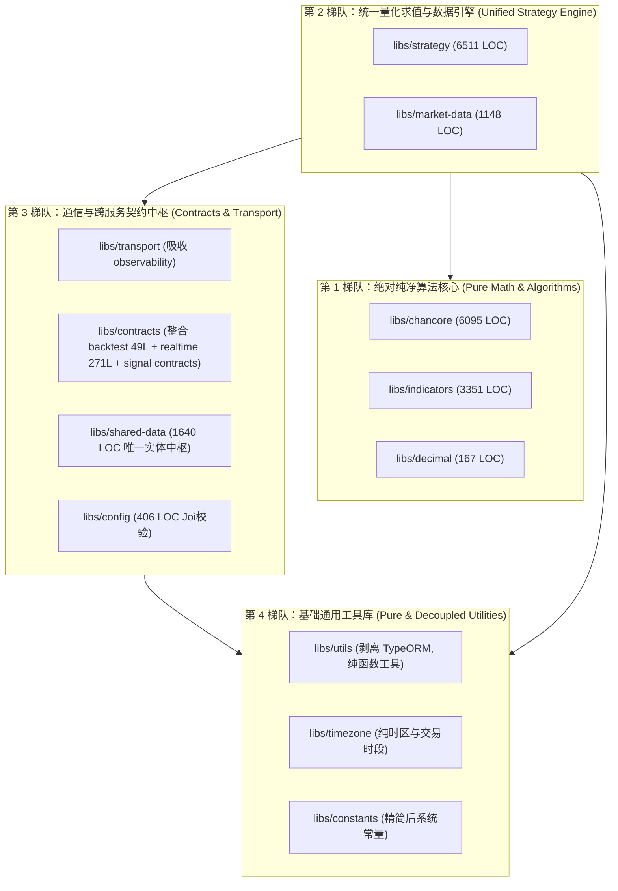

# Design: 辅助函数统一收敛与 Libs 体系系统性瘦身重构

## 1. 总体架构演变 (Four-Tier Architecture)

系统现有 16 个 Libs，通过**“三合并、二下沉、两对齐、一清理”**，整体向四大清晰梯队演进收敛为 11~12 个紧凑库：



---

## 2. 详细技术方案

### 2.1 辅助函数扩充与收敛机制 (`@app/utils` & `@app/timezone`)

#### (1) `@app/utils` 增强纯原语：
- **`type-guards.ts`**：
  ```typescript
  export function isRecord(value: unknown): value is Record<string, unknown> {
    return typeof value === 'object' && value !== null && !Array.isArray(value);
  }
  export function isValidDate(value: unknown): value is Date {
    return value instanceof Date && Number.isFinite(value.getTime());
  }
  ```
- **`security-code.ts`**：
  ```typescript
  export const PROVIDER_SYMBOL_PATTERN = /^(?:\d{6}\.(?:SH|SZ|BJ)|\d{5,6}\.HK)$/;
  export function isProviderSymbol(value: unknown): value is string {
    return typeof value === 'string' && PROVIDER_SYMBOL_PATTERN.test(value);
  }
  ```
- **`error.util.ts`**（新建纯文件）：
  ```typescript
  export function toErrorMessage(error: unknown, fallback = 'unknown error'): string {
    if (error instanceof Error) return error.message;
    if (typeof error === 'string') return error;
    if (error && typeof error === 'object' && 'message' in error && typeof (error as { message: unknown }).message === 'string') {
      return (error as { message: string }).message;
    }
    return String(error || fallback);
  }
  ```
- **`async.util.ts`**（新建纯文件）：
  ```typescript
  export function sleep(ms: number): Promise<void> {
    return new Promise((resolve) => setTimeout(resolve, ms));
  }
  export function withTimeout<T>(
    promise: Promise<T>,
    timeoutMs: number,
    errorFactory?: () => Error,
  ): Promise<T> {
    let timer: NodeJS.Timeout | undefined;
    const timeoutPromise = new Promise<never>((_, reject) => {
      timer = setTimeout(() => {
        reject(errorFactory ? errorFactory() : new Error(`Operation timed out after ${timeoutMs}ms`));
      }, timeoutMs);
    });
    return Promise.race([promise, timeoutPromise]).finally(() => {
      if (timer) clearTimeout(timer);
    });
  }
  ```

#### (2) `@app/timezone` 高性能格式化与会话工具：
- 在 `libs/timezone/src/trading-session.util.ts` 补充纯格式化（利用 `date-fns-tz` 预编译格式化器或快速字符串拼接，杜绝逐帧 `new Intl.DateTimeFormat`）：
  - `formatShanghaiDateString(date: Date): string` -> `YYYY-MM-DD`
  - `formatShanghaiDateTimeString(date: Date): string` -> `YYYY-MM-DD HH:mm`
  - `isSessionCloseBar(timestamp: Date, period: Period): boolean` -> 统一判定是否为日级别收盘 Bar（15:00），消除手写 `(UTC+8)%24`。

---

### 2.2 剥离 `libs/utils` 业务倒灌与切断循环依赖

#### (1) 业务逻辑下沉路径：
- 将以下文件由 `libs/utils/src/services/` 迁移至 `apps/mist/src/sources/services/`：
  - `data-source-selection.service.ts`
  - `data-source.service.ts`
  - `period-mapping.service.ts`
  - `k-boundary-calculator.ts`
- 更新 `apps/mist/src/sources/sources.module.ts`，将其注册为内部 Provider。

#### (2) 净化 `libs/utils` 模块：
- 删除 `libs/utils/src/utils.module.ts` 中的 `@Global()` 声明与 `TypeOrmModule.forFeature([SecuritySourceConfig])`；
- 移除其对 `@nestjs/typeorm` 与 `typeorm` 的全部直接依赖；
- `libs/timezone` 原来为了调用 Axios 实例而依赖 `UtilsService`，改为在 `TimezoneService` 内使用轻量标准 Axios 创建方法或直接接收客户端，彻底破除 `utils` <-> `timezone` 循环引用。

---

### 2.3 物理删除 P1/P2 级死代码与违规根导出

1. **`libs/strategy/src/index.ts`**：
   - 彻底删除 `export { evaluateStrategyPlan }`（仅作为内部插件实现）；
   - 彻底清理对 `@app/market-data` 的 24 个重复 re-export。
2. **`libs/utils/`**：
   - 物理删除 `src/aggregate.ts` 与 `src/aggregate.spec.ts`（生产 0 引用）；
   - 删除 `security-code.ts` 中的 `isEtfSecurity` 与 `isChiNextOrStarMarket`（统一收敛到 `@app/market-data`）。
3. **`libs/strategy/`**：
   - 物理删除 `strategy-context-snapshot.serializer.ts`（已废弃）；
   - 物理删除 `http-proxy.plugin.ts`（空壳未接入插件）。
4. **`libs/constants/`**：
   - 清理 `errors.ts` 中的 23 个僵尸常量；
   - 清理 `market.constants.ts` 中的过时费率字段。
5. **`libs/market-data/`**：
   - 物理删除未使用的 `MarketDataPipelineError` 异常类。
6. **`libs/observability/`**：
   - 物理删除生产 0 引用的 `sanitizeLowCardinalityLabel` 与 `safeMetricNumber`。

---

### 2.4 微库合并与重组 (`observability`, `contracts`, `strategy`)

1. **合并 `libs/observability` 到 `libs/transport`**：
   - 将 `base-health.vo.ts` 与 `metric-utils.ts` 迁入 `libs/transport/src/observability/`；
   - 更新所有应用的 Health Controller 引用路径为 `@app/transport/http` 或 `@app/transport`；
   - 移除 `libs/observability` 目录与配置。
2. **整合建立 `libs/contracts` 统一契约中枢**：
   - 目录结构：
     - `libs/contracts/src/backtest/`：迁移原 `libs/backtest` 的 `SubmitBacktestRunCommandV1`；
     - `libs/contracts/src/realtime/`：迁移原 `libs/realtime` 的 Redis candle 结构与 Key 格式；
     - `libs/contracts/src/signal/`：迁移原 `libs/signal/src/contracts/` 下的 BullMQ 与 RPC 任务定义；
   - 彻底删除独立 49 行的 `libs/backtest` 与 271 行的 `libs/realtime`。
3. **推流器回归 `libs/strategy`**：
   - 将 `RealtimeKernelPool` 与 `RealtimePeriodBuilder` 由 `libs/signal/src/runtime/` 迁至 `libs/strategy/src/kernel/adapters/`；
   - 解开 `strategy-pipeline-homogeneity.guard.spec.ts` 对 `@app/signal` 的反向依赖。

---

## 3. 防退化与架构门禁设计

为确保重构过程零意外中断、零构建失效，必须守住以下四道门禁：

1. **三大刚性架构门禁 (Three Rigid Guardrails)**：
   - `dev-server-boundary.guard.spec.ts`：100% 保持通过；
   - `strategy-pipeline-homogeneity.guard.spec.ts`：100% 保持通过；
   - `strategy-dual-timestamp.guard.spec.ts`：100% 保持通过。
2. **构建与路径映射一致性**：
   - 每次调整 lib，必须同步更新：
     - `tsconfig.json` 的 `compilerOptions.paths`；
     - `nest-cli.json` 的 `projects` 映射；
     - `package.json` 中的 Jest `moduleNameMapper`。
3. **Docker 镜像构建守门**：
   - 确保 `pnpm run build:docker` 中列出的各应用编译不受任何缺失 module 影响。
4. **单测覆盖率齿轮门禁 (Coverage Ratchet)**：
   - 删除死代码后，总行数减少，行覆盖率底线只升不降（保持 ≥82.72%）。
