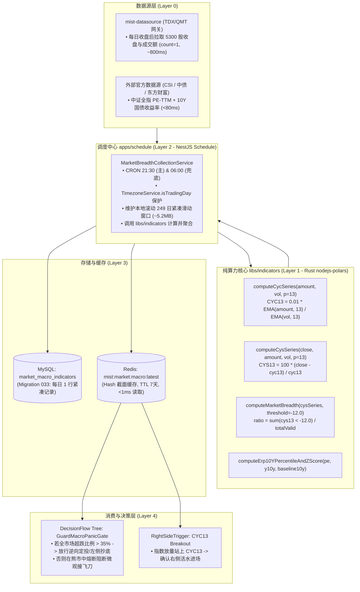
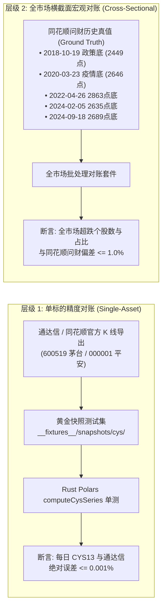

# Design: CYS13 Market Breadth and Panic Gauge Architecture (全市场 CYS13 超跌宽度与恐慌极值架构设计)

## 1. 架构总览与分层职责



---

## 2. 核心数学模型与公式标准化

### 2.1 正统成本均线（CYC）
在 A 股行情规范中，成交金额 `amount` 单位为元，成交量 `volume` 单位为手（1手 = 100股）：
$$\text{EMA\_AMOUNT}_t = \alpha \times \text{amount}_t + (1 - \alpha) \times \text{EMA\_AMOUNT}_{t-1}$$
$$\text{EMA\_VOL}_t = \alpha \times \text{volume}_t + (1 - \alpha) \times \text{EMA\_VOL}_{t-1}$$
$$\text{CYC}_N(t) = \frac{0.01 \times \text{EMA\_AMOUNT}_t}{\text{EMA\_VOL}_t}$$
其中 $\alpha = \frac{2}{N + 1}$。对于 13 日成本均线，$\alpha = \frac{2}{14} = \frac{1}{7}$。
*(若底层行情数据 volume 已转换为“股”，则无需乘 0.01，直接为 $\text{EMA\_AMOUNT} / \text{EMA\_VOL}$)*。

### 2.2 市场盈亏指标（CYS）
$$\text{CYS}_N(t) = \frac{\text{close}_t - \text{CYC}_N(t)}{\text{CYC}_N(t)} \times 100$$
- $\text{CYS13} > 0$：持筹者平均浮盈，数值越大获利盘越重；
- $\text{CYS13} < 0$：持筹者平均套牢；$\text{CYS13} < -12\%$ 为深度套牢区。

### 2.3 全市场 CYS13 超跌宽度（Panic Breadth）
在交易日 $t$，剔除全市场处于停牌、退市整理期或上市不满 30 日的无流动性股票后，得到当日有效可交易股票池 $\mathcal{S}_t$（大小为 $M_t \approx 5000 \sim 5300$）：
$$\text{Breadth}_{CYS13}(t) = \frac{1}{M_t} \sum_{i \in \mathcal{S}_t} \mathbb{I}\left( \text{CYS13}_{i, t} < -12.0 \right)$$
- **区间定义**：
  - $[0.00, 0.08]$：常态运行区（市场平稳或牛市主升）；
  - $(0.08, 0.25]$：中度调整区（结构性回踩）；
  - $(0.25, 0.40]$：恐慌预警区（系统性下行）；
  - $> 0.40$（甚至 $> 0.50$）：**极度恐慌出清区（Capitulation Bottom）**，触发宏观逆向播种。

---

## 3. 数据层增量设计与持久化方案

### 3.1 数据库 Migration `033_create_market_macro_indicators.sql`
```sql
CREATE TABLE IF NOT EXISTS `market_macro_indicators` (
  `id` INT UNSIGNED NOT NULL AUTO_INCREMENT,
  `trading_date` DATE NOT NULL COMMENT '交易日 YYYY-MM-DD',
  `breadth_cys13_oversold_ratio` DECIMAL(6, 4) NOT NULL COMMENT '全市场CYS13<-12%超跌比例 (0.0000 - 1.0000)',
  `breadth_above_ma250_ratio` DECIMAL(6, 4) NOT NULL COMMENT '全市场站上MA250比例 (0.0000 - 1.0000)',
  `all_a_turnover_rate` DECIMAL(8, 4) NULL COMMENT '全A当日换手率 (%)',
  `all_a_turnover_percentile_10y` DECIMAL(6, 4) NULL COMMENT '全A换手率10年分位点 (0.0000 - 1.0000)',
  `china_10y_bond_yield` DECIMAL(6, 4) NULL COMMENT '中国10年期国债到期收益率 (%)',
  `index_pe_ttm` DECIMAL(8, 4) NULL COMMENT '中证全指/沪深300滚动市盈率 PE-TTM',
  `erp_ratio` DECIMAL(8, 4) NULL COMMENT '股债性价比 ERP = 1/PE - 10Y国债收益率 (%)',
  `erp_percentile_10y` DECIMAL(6, 4) NULL COMMENT 'ERP 10年分位点 (0.0000 - 1.0000)',
  `erp_zscore_10y` DECIMAL(6, 4) NULL COMMENT 'ERP 10年 Z-Score 标准分',
  `sample_count` INT UNSIGNED NOT NULL DEFAULT 0 COMMENT '当日统计有效样本股票数',
  `created_at` DATETIME NOT NULL DEFAULT CURRENT_TIMESTAMP,
  `updated_at` DATETIME NOT NULL DEFAULT CURRENT_TIMESTAMP ON UPDATE CURRENT_TIMESTAMP,
  PRIMARY KEY (`id`),
  UNIQUE KEY `uk_trading_date` (`trading_date`),
  KEY `idx_trading_date_erp` (`trading_date`, `erp_ratio`)
) ENGINE=InnoDB DEFAULT CHARSET=utf8mb4 COLLATE=utf8mb4_unicode_ci COMMENT='全市场宏观与宽度指标表';
```

### 3.2 Redis 极速门禁键设计
- **Key**：`mist:market:macro:latest` (Type: Hash, TTL: 7 天)
- **Fields**：
  - `tradingDate`: 'YYYY-MM-DD'
  - `breadthCys13Oversold`: '0.4521'
  - `breadthAboveMa250`: '0.0834'
  - `turnoverPercentile10y`: '0.0410'
  - `erpPercentile10y`: '0.9820'
  - `isPanicCapitulation`: '1' (当超跌比例 > 0.35 且换手 < 0.10 时置 1)
  - `updatedAt`: ISO 8601 Timestamp

---

## 4. 双层金标准对账验证体系（Parity Reconciliation Framework）

为彻底杜绝“自说自话、与外部市场不一致”的伪量化问题，确立严格的双层对账标准：



### 4.1 层级 1：单标的通达信黄金对账（Single-Asset Parity）
- 选取代表性资产（贵州茅台 `600519` 与平安银行 `000001`）过去 250 天真实行情；
- 导出通达信标准 `CYS13` 列与 `CYC13` 列；
- 单测验证：
  - 边界情况：停牌日处理（Volume = 0 时保持前值）、无除零异常；
  - 预热保证：前 30 根 Bar 预热后，后续所有交易日误差 $\le 10^{-4}$。

### 4.2 层级 2：全市场历史极端日横截面对账（Cross-Sectional Breadth Parity）
- **真值来源**：同花顺问财（iWenCai）历史客观检索结果：
  - `2024-02-05`（雪球集中爆仓日）：正常交易 A 股 5092 只，CYS13 < -12% 约 3320 只，占比 $\approx 65.2\%$；
  - `2024-09-18`（脉冲启动前夕）：超跌比例显著收敛至 $\approx 18.5\%$；
  - `2022-04-26`（2863点底）：超跌比例 $\approx 51.8\%$；
  - `2018-10-19`（2449点底）：超跌比例 $\approx 47.6\%$；
- **对账门禁**：离线批处理运行结果与问财历史基准比对，容差 $\le \pm 1.0\%$（允许因新股上市首月或停牌定义产生的微弱偏差）。


