# Design: Tactical Window Containment Keep-Alive and Autonomous Plugin Policy

## 1. 架构总览与时空协同模型

本设计遵循“**形态归空间压缩，时序归物理推进**”的第一性原理：
- **物理时序主干**：成交量积分（VPCI）、波动率（布林挤压）以及 Next-Bar 撮合执行继续运行在单调物理时间轴上，保障因果律与回测 100% 保真；
- **微观智能保活**：时序观察窗在检测到内包含孕线（Inside Bar）时，视作形态未展开的微观蓄势，自动冻结倒计时消耗；
- **插件自治策略**：观察窗参数（`windowBars`, `maxContainmentHoldBars`）从系统写死清单中解耦，由触发插件通过信号自主携带。

```mermaid
flowchart TD
    subgraph TriggerPhase ["1. 扳机开窗期 (Bar t)"]
        TriggerPlugin["触发插件 (Trigger Factor Plugin)"] -->|emit Signal with evidence| WinEngine["时序观察窗引擎 (TemporalWindowEngine)"]
        WinEngine --> ReadPolicy["动态提取策略:<br/>windowBars = signal.evidence?.windowBars ?? 3<br/>maxHold = signal.evidence?.maxContainmentHoldBars ?? 2<br/>pivotPrice = signal.pivotPrice"]
        ReadPolicy --> OpenWin["开辟活跃观察窗 (ActiveObservationWindow)"]
    end

    subgraph StepPhase ["2. 逐 Bar 推进期 (Bar t+k)"]
        PushBar["内核推入下一根物理 Sealed Bar"]
        PushBar --> CheckStopLoss{"收盘价跌破 pivotPrice?<br/>bar.close < pivotPrice"}
        CheckStopLoss -->|是: 结构破位| DropInvalid["即刻清退注销 (Invalidated)"]
        
        CheckStopLoss -->|否: 结构有效| CheckInside{"是否为孕线包含?<br/>high <= prevHigh && low >= prevLow"}
        
        CheckInside -->|是: 包含关系| CheckHoldLimit{"包含保活计数 < maxHold?"}
        CheckHoldLimit -->|未超配额| Freeze["冻结倒计时消耗!<br/>heldContainmentBars++<br/>窗口继续保活"]
        CheckHoldLimit -->|超过配额| Advance["耗尽保活额度，消耗 1 根倒计时<br/>elapsedEffectiveBars++"]
        
        CheckInside -->|否: 走出新高/低| Advance
        
        Freeze --> CheckConfirm
        Advance --> CheckTimeout{"elapsedEffectiveBars > windowBars?"}
        CheckTimeout -->|超时| DropExpire["超时清退注销 (Expired)"]
        CheckTimeout -->|未超时| CheckConfirm{"当根 Bar 命中<br/>VPCI 放量突破?"}
        
        CheckConfirm -->|命中确认| Synthesize["合成 TacticalEvent 战术事件!"]
        CheckConfirm -->|未命中| WaitNext["保留窗口，等待下一根 Bar"]
    end
```



---

## 2. 核心数据结构扩展

### 2.1 缠论几何载荷扩展 (`chan-bsp.plugin.ts`)
```typescript
export interface ChanMergedKGeometry {
  readonly index: number;
  readonly high: number;
  readonly low: number;
  readonly startTime: string;
  readonly endTime: string;
  readonly trend: string;
  readonly mergedCount: number;
}

export interface ChanGeometryPayload {
  readonly channels: readonly ChanZhongshuGeometry[];
  readonly bis: readonly ChanBiGeometry[];
  readonly fenxings?: readonly unknown[];
  readonly latestChannel?: ChanZhongshuGeometry;
  readonly latestBi?: ChanBiGeometry;
  
  // === 新增官方合并 K 线透传 ===
  readonly mergedKs: readonly ChanMergedKGeometry[];
  readonly latestMergedIndex: number;
  readonly isLatestContained: boolean;
}
```

### 2.2 活跃观察窗模型扩展 (`temporal-window-engine.ts`)
```typescript
interface ActiveObservationWindow {
  readonly windowId: string;
  readonly rule: TacticalWindowRule;
  readonly triggerSignal: KernelSignal;
  readonly triggerBarIndex: number;
  readonly openTimestamp: Date;
  readonly confirmingSignals: KernelSignal[];
  readonly pendingTags: Set<string>;
  readonly boostSignals: KernelSignal[];

  // === 动态策略与智能保活追踪 ===
  readonly targetWindowBars: number;
  readonly maxContainmentHoldBars: number;
  readonly stopLossPrice: number | null;
  
  /** 已经消耗的有效推进物理 Bar 数量 */
  elapsedEffectiveBars: number;
  /** 已经经历的孕线包含保活 Bar 数量 */
  heldContainmentBars: number;
  /** 上一根物理 Bar 的极值缓存，用于 Inside Bar 判定 */
  lastBarRange: { high: number; low: number };
}
```

---

## 3. 算法流转与边界保障

1. **开窗初始化**：
   ```typescript
   const targetWindowBars =
     typeof signal.evidence?.windowBars === 'number'
       ? signal.evidence.windowBars
       : rule.windowBars ?? DEFAULT_TACTICAL_WINDOW_BARS;

   const maxContainmentHoldBars =
     typeof signal.evidence?.maxContainmentHoldBars === 'number'
       ? signal.evidence.maxContainmentHoldBars
       : rule.maxContainmentHoldBars ?? DEFAULT_MAX_CONTAINMENT_HOLD_BARS;

   const stopLossPrice =
     typeof signal.pivotPrice === 'number' ? signal.pivotPrice : null;
   ```

2. **步进检查与破位一票否决**：
   - 若 `stopLossPrice != null && bar.close < stopLossPrice`：形态已完全被空头击穿，未决多头观察窗立即作废；
   - 若 `bar.high <= win.lastBarRange.high && bar.low >= win.lastBarRange.low`：
     - 若 `win.heldContainmentBars < win.maxContainmentHoldBars`：
       `win.heldContainmentBars++`，窗口保留，不计入 `elapsedEffectiveBars`；
     - 否则：保活配额用尽，正常步进 `win.elapsedEffectiveBars++`；
   - 若走出新高或新低（非包含）：
     - `win.elapsedEffectiveBars++`，更新 `win.lastBarRange = { high: bar.high, low: bar.low }`；
   - 若 `win.elapsedEffectiveBars > win.targetWindowBars`：注销过期窗口。
