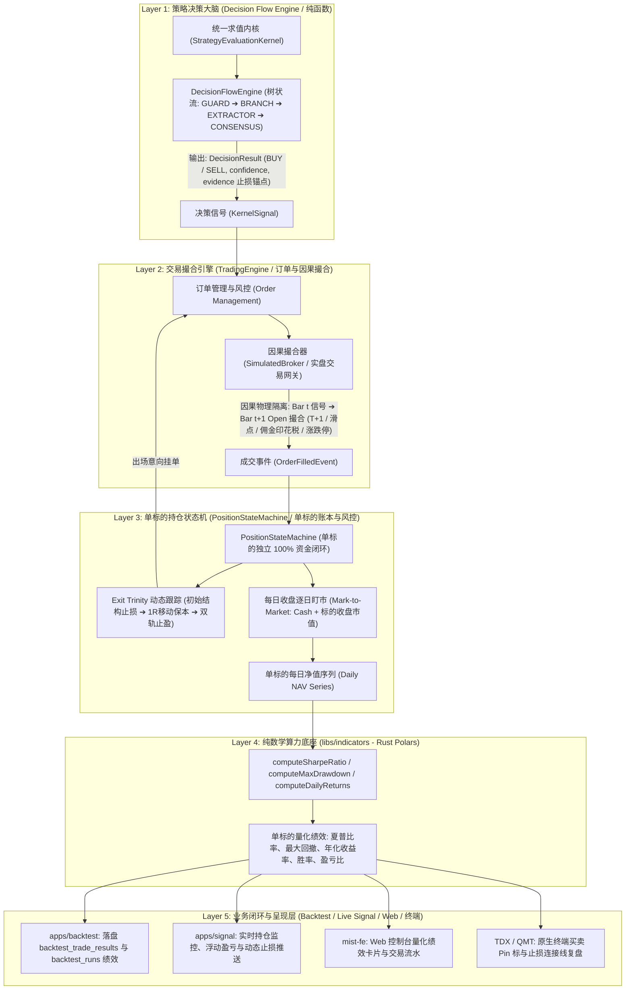
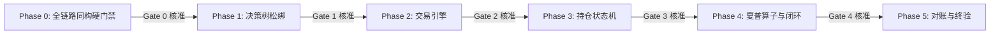

# Design: 量化决策执行同构架构、交易引擎与持仓状态机体系

## 1. 架构总览与分层拓扑（三层单向数据流）

为解决系统「有决策大脑，无执行手脚」以及回测与实时链路割裂的核心痛点，本设计将量化策略执行链路划分为严格单向依赖的体系。
**全链路刚性同构红线：除数据流转方式（实时是 push 驱动，回测是 pull 循环）之外，其他所有数据模型、字段、计算逻辑与落盘处理必须 100% 保持一致**。

---

## 2. 核心架构边界定界：单标的模式 A（Single-Security Model）

### 2.1 物理现实与模式 A 锁定
根据系统实际代码机制（`backtest-run.executor.ts:214` 循环 `for (const target of targets) await replaySecurity(...)`）：
- **物理事实**：回测在执行层是**按标的独立串行回放一整年历史**。标的之间在时间线上相互隔离，物理上不存在多标的同一时间戳并发；
- **模式 A 规范（锁定）**：
  1. 系统明确采用**单股票独立持仓状态机模型**（每个标的分配独立的虚拟初始资金，如 100 万元）；
  2. 每个标的独立完成“开仓 $\rightarrow$ Exit Trinity 出局三部曲 $\rightarrow$ 逐日盯市”，生成该标的专属的**单标的每日净值曲线（NAV Series）**；
  3. 计算出的夏普率代表**“该策略在该标的上的独立盈亏质量与风险收益比”**；
  4. 一次回测若包含多只股票，回测引擎产出各个标的的独立绩效指标与流水明细（任务汇总层可计算各标的夏普率的等权均值）；
  5. **明确 Non-Goal**：多股票共享母资金池、按时间切片时钟同步步进、动态仓位竞争抢占的 Portfolio 组合回测，确立为下一阶段的独立演进课题。

---

## 3. 标的身份全局统一：全面拥抱 `security_id`，废弃 `security_code`

### 3.1 统一规范
- 全系统信号层与执行层**唯一使用 `security_id` (INT NOT NULL, FK→securities.id)** 作为标的身份标识；
- **废除对 `security_code` 字符串列的依赖**：
  - 实时表 `strategy_signals` 保持纯粹的 `security_id`（外键关系，杜绝代码拼写错误或股票更名数据污染）；
  - 回测表 `backtest_signal_results` 补齐 `security_id`（FK 约束），停止依赖字符串代码；
  - 若前端或终端展示需要股票代码/名称，统一通过 `security_id` 关联 `securities` 主表获取。

---

## 4. 全链路同构硬门禁：消除推拉之外的所有差异

依据全链路审计清单，必须在首期全面对齐以下四大维度的系统隐患：

### 4.1 维度 1：数据表与持久化 100% 镜像对齐
1. **Migration 027 双向补齐**：
   - `strategy_signals` 补齐 `signal_type VARCHAR(32) NOT NULL DEFAULT 'signal'`（解决对账脚本崩溃及细分买卖点缺失）；
   - `backtest_signal_results` 补齐 `security_id` (INT, FK)、`strategy_definition_id`、`strategy_version_id`、`period`、`source`、`signal_kind`、`signal_source`；
   - `backtest_runs` 增加 `prewarm_status`、`prewarm_min_actual`、`prewarm_min_expected`。
2. **修复回测落盘致命 Bug**：
   - 修复 `backtest-run.executor.ts:330-341` 在 `this.resultRepository.insert` 映射中漏写 `pivotTime` 的 Bug，确保形态极值时间正确落库；
   - 统一在两端将当期撮合基准价 `triggerPrice` 与 `triggerTime` 规范注入 `context_snapshot`（或持久化一等列）。
3. **修复实时告警去重键阻断复合信号 Bug**：
   - 修改 `liveStrategyAlertDedupeKey`，在哈希段中加入 `candidate.signalType`，确保同一 Bar 上的多个不同买卖点（如一买、二买）不会因告警表唯一键冲突而导致信号回滚。

### 4.2 维度 2：预热机制与内核上下文完全归一
1. **消除预热数量 `+1` 偏置**：
   - 实时侧 `loadRealtimeWindow` 移除 `criteria.requiredBars + 1` 的隐式硬编码，两端严格以 `requiredBars` 为基准；
2. **修复回测盘中预热切分割裂**：
   - 回测 `preWarmEndAt` 从死锁的 09:30 改为对齐 `run.startDate`，确保回测与实时在盘中启动时的预热段完全一致；
3. **修复实时内核上下文标的标识失真**：
   - 修复 `RealtimeKernelPool.buildGroup` 错误传入数字 ID `String(bar.securityId)` 的问题，向 Kernel 传入统一规范的标识。

### 4.3 维度 3：Bar 规范化与策略编译清洗下沉
1. **下沉 OHLC 四价几何拓扑校验**：
   - 将 `low <= min(o,c)` 与 `high >= max(o,c)` 的合法性校验下沉至共享 `libs/market-data`，回测读库时统一执行；
2. **统一量额十进制清洗**：
   - 实时侧封存 K 线映射时补齐调用 `normalizeExternalDecimalText`；
3. **统一规则快照与 Schema 门禁**：
   - 回测执行器向 Kernel 及结果表传递编译归一化后的 `compiled.ruleSnapshot`，补齐 `ruleSchemaVersion === V1` 校验。

### 4.4 维度 4：修复游标统计泄漏
- 在 `historical-bar-source.ts` 中加入单调时间戳防御，遇到内核拒绝的乱序/重复 Bar 时，**严禁累加 `barCount`，严禁触发 `onBar` 回调**，彻底杜绝回测配额被误扣损耗。

---

## 5. 防未来函数向交易层转移与决策树松绑

### 5.1 交易层接管因果律（物理时序隔离）
- **Next-Bar Open 成交法则**：
  Bar $t$ 闭合确认决策信号；交易引擎在 Bar $t+1$ 以开盘价 `bar.open`（叠加滑点）撮合成交：
  $$t_{\text{fill}} \ge t+1 > t_{\text{signal}}$$
  在时间轴上物理阻隔，彻底消除同 Bar 穿越或极值点未来成交。

### 5.2 决策树与信号层全面解绑
1. **剥离虚拟成交价**：信号层不再假定自己能在当根 Bar 的 `close` 价格成交，移除虚拟撮合逻辑；
2. **卸除因子插件交易防重负担**：插件（如 `ChanBspFactorPlugin`）内部只做纯数学形态去重，不再背负跨 Bar 开仓防重的责任；下游单标的持仓状态机处于 `Holding` 状态时，交易引擎天然忽略同向开仓信号；
3. **保留纯数据因果律**：滑动窗口严格禁止灌入未来 K 线。

---

## 6. 交易引擎设计（`TradingEngine`）

- 模块路径：`libs/strategy/src/execution/`
- 核心契约：
  - `Order`：包含 `orderId`, `securityId`, `side: 'BUY' | 'SELL'`, `orderType`, `quantity`, `signalTime`, `initialStopLossPrice`；
  - `OrderFilledEvent`：包含实际成交时刻 `fillTime`、成交均价 `fillPrice`、成交股数、费用明细（佣金、过户费、印花税）；
- A 股严格模拟撮合模型（`SimulatedBroker`）：
  - Next-Bar Open 成交与滑点（默认 0.1%）；
  - T+1 锁定（当日买入可用股数为 0，禁止日内平仓）；
  - 涨停一字板买入拒单（`BUY_REJECTED_LIMIT_UP`）；
  - 跌停一字板卖出顺延（`SELL_BLOCKED_LIMIT_DOWN`，延至次一交易日继续撮合）；
  - 双向万 2.5 佣金（最低 5 元）、过户费、卖出单向 0.05% 印花税（支持 ETF 免征印花税判定）。

---

## 7. 单标的持仓生命周期状态机设计（`PositionStateMachine`）

- 模块路径：`libs/strategy/src/position/`
- 核心设计哲学（主私仓库战略隔离与收益率保护）：
  1. **主仓库以持仓管理与记账为主，零死板止损**：
     - 避免因假摔或震荡洗盘机械打止损造成频繁割肉、磨损手续费并拉低复合收益率；
     - 主仓库内部默认仅依托决策流的**反向卖点信号（`signalKind === 'exit'`）**离场；
  2. **专有止损/出场插件物理隔离至私有仓**：
     - 严守开源/公共仓资产安全红线，复杂的 ATR 移动止损、网格风控等策略资产沉淀于私有仓库；
     - 主仓库提供与决策树因子插件（`FactorPlugin`）高度同构的扩展端口（`ExitPolicyPort`），支持无缝装配私有仓专有插件；
- 状态迁移：
  `EMPTY` ➔ `HOLDING` ➔ `CLOSED`
- 生命周期与账本事实：
  - 记录 `entryTime`, `costPrice`, `holdingQuantity`, `holdingBars`, `realizedPnl`, `unrealizedPnl`；
  - 消费 `SimulatedBroker` 的真实 `OrderFilledEvent` 进行准确记账；
- **每日收盘逐日盯市（Mark-to-Market）**：
  在每日 15:00 收盘时刻计算单标的总权益：$NAV_t = Cash_t + Position_t \times Close_t$，生成连续纯净的 `Daily NAV Series` 净值曲线。

---

## 8. 夏普率与量化绩效指标计算（`libs/indicators` Rust Polars）

在纯数学指标层实现标准向量化算子：
- $\text{Daily Return: } R_t = \frac{NAV_t - NAV_{t-1}}{NAV_{t-1}}$
- $\text{Annualized Sharpe Ratio: } \text{Sharpe} = \frac{\text{mean}(R_t) - (R_f / 250)}{\text{std}(R_t, ddof=1)} \times \sqrt{250}$
- 函数接口：`computeDailyReturns`、`computeSharpeRatio`、`computeMaxDrawdown`、`computeCalmarRatio`。

---

## 9. 分阶段工程门禁与人机交互治理机制（Phase Gates & Verification Governance）

### 硬性治理铁律（Mandatory Checkpoint & Zero Auto-Advance）
1. **单阶段严格闭环**：任务与代码严格限制在当前 Phase，严禁跨 Phase 提前编写；
2. **强制人机停顿（Mandatory Halt）**：每个 Phase 完成后，系统**必须立即停顿**，向人类工程师提交《Phase 交付与审计报告》；
3. **人类授权解锁（Explicit Sign-off）**：未获得人类明确回复（如“批准 Phase X / 进入 Phase X+1”）前，**绝对禁止自动启动下一 Phase**；
4. **逐阶段共同走通**：每个 Phase 实施前后由人类工程师与 Agent 共同核对验收。
